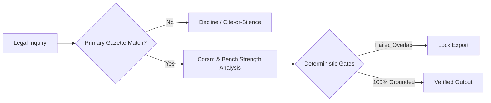

# AdvocateVox

```text
 █████╗ ██████╗ ██╗   ██╗ ██████╗  ██████╗ █████╗ ████████╗███████╗    ██╗   ██╗ ██████╗ ██╗  ██╗
██╔══██╗██╔══██╗██║   ██║██╔═══██╗██╔════╝██╔══██╗╚══██╔══╝██╔════╝    ██║   ██║██╔═══██╗╚██╗██╔╝
███████║██║  ██║██║   ██║██║   ██║██║     ███████║   ██║   █████╗      ██║   ██║██║   ██║ ╚███╔╝ 
██╔══██║██║  ██║╚██╗ ██╔╝██║   ██║██║     ██╔══██║   ██║   ██╔══╝      ╚██╗ ██╔╝██║   ██║ ██╔██╗ 
██║  ██║██████╔╝ ╚████╔╝ ╚██████╔╝╚██████╗██║  ██║   ██║   ███████╗     ╚████╔╝ ╚██████╔╝██╔╝ ██╗
╚═╝  ╚═╝╚═════╝   ╚═══╝   ╚═════╝  ╚═════╝╚═╝  ╚═╝   ╚═╝   ╚══════╝      ╚═══╝   ╚═════╝ ╚═╝  ╚═╝
```

> *"Fiat Justitia, Ruat Caelum — In the sanctum of jurisprudence, an unverified citation is perjury; an invented precedent is an assault on justice. AdvocateVox stands upon an immutable canon: **Cite or stay silent**. Every clause traced to the Gazette, every holding bound to the coram, every word voiced in cryptographic truth."*

<div align="center">

[](LICENSE)
[](test/)
[](https://nodejs.org/)
[-FF6F00?style=flat-square)](package.json)
[](#)
[](#speech-synthesis--neural-voice)

</div>

---

## 3D System Architecture

```text
                      +-----------------------------------------------+
                     /                                               /|
                    /                 ADVOCATE VOX                  / |
                   /      Voice-First Legal Intelligence Engine    /  |
                  +-----------------------------------------------+   |
                  |  LAYER 5: PRESENTATION & NEURAL VOICE         |   |
                  |  - Sarvam Bulbul v3 / Device TTS (en-IN)      |   |
                  |  - Practice Workbench & Semantic Web Studio   |   +
                  +-----------------------------------------------+  /|
                  |  LAYER 4: DETERMINISTIC VERIFICATION GATES    | / |
                  |  - Sentence-level source attribution match    |/  |
                  |  - Locked Word .docx export pipeline          |   +
                  +-----------------------------------------------+  /|
                  |  LAYER 3: PRECEDENT & CORAM GRAPH             | / |
                  |  - Bench strength weighting (1 to 13 judges)  |/  |
                  |  - Author vs Concurrence vs Dissent analysis  |   +
                  +-----------------------------------------------+  /|
                  |  LAYER 2: STATUTORY TEMPORAL MATRIX           | / |
                  |  - BNS/BNSS/BSA <-> IPC/CrPC/IEA transitions  |/  |
                  |  - Point-in-time gazette amendment history    |   +
                  +-----------------------------------------------+  /
                  |  LAYER 1: CRYPTOGRAPHIC GAZETTE VAULT         | /
                  |  - egazette.gov.in TLS auto-chain completion  |/
                  |  - SHA-256 immutable store & FTS5 BM25 index  |
                  +-----------------------------------------------+
                   \_______________________________________________\/
```

---

## Verification Pipeline: Cite-or-Silence

AdvocateVox rejects generative hallucinations. If an official gazetted provision or judicial holding cannot be proven down to paragraph and date, the engine declines to answer.

```text
        +-------------------+
       /    LEGAL QUERY    /|
      +-------------------+ |
      | Query + As-Of Date| +
      +-------------------+/
               |
               v
     +-------------------+
    /   PRIMARY VAULT   /|
   +-------------------+ |
   | Gazette Retrieval | +
   +-------------------+/
          /         \
   [Found]           [Not Found]
        /             \
       v               v
  +-----------+   +-------------------------------+
 /  SC GRAPH /|  /     SILENCE SINK (DECLINE)    /|
+-----------+ | +-------------------------------+ |
| Coram &   | + | Deterministic Refusal Matrix  | +
| Precedent |/  | Zero-Hallucination Boundary   |/
+-----------+   +-------------------------------+
      |
      v
  +-----------------------+
 /  VERIFICATION GATE    /|
+-----------------------+ |
| Literal Quote Match   | +
| Sentence-Level Audit  |/
+-----------------------+
      |             \
   [Pass]         [Fail]
      |               \
      v                v
  +-----------+   +-------------------+
 /  OUTPUT   /|  /   EXPORT LOCKED   /|
+-----------+ | +-------------------+ |
| Docx / Vox| + | Unverified Export | +
| Synthesis |/  | Prohibited        |/
+-----------+   +-------------------+
 \___________\/  \___________________\/
```



---

## 3D Execution Pipeline

```text
  +---------+       +---------+       +---------+       +---------+
 / INGEST  /| ===> / TEMPORAL/| ===> / CORAM   /| ===> / SYNTH   /|
+---------+ |     +---------+ |     +---------+ |     +---------+ |
| Gazette | +     | As-Of   | +     | Bench   | +     | Voice & | +
| Source  |/      | Matrix  |/      | Graph   |/      | .DOCX   |/
+---------+       +---------+       +---------+       +---------+
     |                 |                 |                 |
 [SHA-256]         [BM25 FTS5]      [SCR Parser]      [Deterministic]
```

---

## Core Capabilities

- **Statutory Grounding**: Queries official gazetted acts (*Constitution of India, BNS, BNSS, BSA*) via SQLite FTS5 BM25 with Porter stemming. Out-of-date or unverified provisions trigger an explicit decline.
- **e-Gazette TLS Completion**: Recursively fetches missing intermediate CA certificates from AIA headers for `egazette.gov.in`, ensuring reliable ingestion without TLS failures.
- **Point-in-Time History**: Preserves exact statutory snapshots per enactment date; flags judicial invalidations (e.g. NJAC 99th Constitutional Amendment).
- **Bare Act Copy Checker**: Compares local PDFs or mirror URLs against official Gazette text to surface altered text or missing amendments.
- **Precedent & Coram Graph**: Analyzes Supreme Court judgments from AWS Open Data, decomposing corams by bench strength, author, concurrence, and dissent.
- **Practice Workbench**: Constructs court-ready structures for Bail, FIR intake, Civil Adjournments, and Opinions with strict separation of incident, station, and court facts.
- **Deterministic Legal Reports**: Generates formal reports with numbered authorities; locks Word `.docx` export unless 100% of claims pass literal quotation and source-overlap checks.
- **Cyber-Law Indexing**: IT Act 2000 (§§ 43 & 66 as of June 2025), DPDP Act 2023, Intermediary Guidelines, and CERT-In directions.

---

## Statutory Transition Matrix

```text
           +-------------------------------------------------------+
          /              STATUTORY TRANSITION MATRIX              /|
         +-------------------------------------------------------+ |
         | HISTORIC CODE       CONTEMPORARY CODE  CHANGE VECTOR  | |
         | ----------------------------------------------------- | |
         | IPC § 302 (Murder)  BNS § 103(1)       Penalty held   | |
         | IPC § 420 (Cheat)   BNS § 318(4)       Offence pooled | |
         | CrPC § 167 (Remand) BNSS § 187         Phased custody | |
         | IEA § 65B (Electr.) BSA § 61           Hash & cert    | |
         +-------------------------------------------------------+ |
          \_______________________________________________________\/
```

| Historic Code | Contemporary Code | Legal Vector |
| :--- | :--- | :--- |
| **IPC § 302** (Murder) | **BNS § 103(1)** | Substantive penalty preserved |
| **IPC § 420** (Cheating) | **BNS § 318(4)** | Restructured economic offence category |
| **CrPC § 167** (Remand) | **BNSS § 187** | Extended phased police custody windows |
| **IEA § 65B** (Electronic Evidence) | **BSA § 61** | Modernized certification and hash standards |

---

## Command Line Interface

```text
   +-------------------------------------------------------------------------+
  /  TERMINAL CONSOLE -- ADVOCATE VOX                                       /|
 +-------------------------------------------------------------------------+ |
 | $ npm run cli -- search --act BNS --as-of 2024-07-01 "murder"           | |
 |                                                                         | |
 |   ACT:         Bharatiya Nyaya Sanhita, 2023 (Act 45 of 2023)           | |
 |   PROVISION:   Section 103(1) - Punishment for murder                   | |
 |   AS-OF:       2024-07-01 (Commencement: 2024-07-01)                    | |
 |   SHA-256:     e3b0c44298fc1c149afbf4c8996fb92427ae41e4649b934ca495991 | |
 |   CROSSWALK:   IPC Section 302 -> BNS Section 103(1)                    | |
 |   STATUS:      VERIFIED (Primary Gazette: egazette.gov.in)              | |
 +-------------------------------------------------------------------------+ |
  \_________________________________________________________________________\/
```

```bash
# Grounded statutory search
npm run cli -- search "right to education"

# Point-in-time date query
npm run cli -- search --act BNS --as-of 2024-07-01 "culpable homicide"

# Catalog & coverage lookup
npm run cli -- catalog "DPDP Rules"

# Statutory correspondence
npm run cli -- lookup IPC 302
npm run cli -- lookup CrPC 167

# Bare act integrity verification
npm run cli -- check-copy https://example.org/bare-act.pdf

# Official document cryptographic import
npm run cli -- import <local-file> <official-url>
```

---

## Sovereign Runtime Architecture

Built exclusively on Node.js built-ins. Zero external runtime npm dependencies.

```text
   +-------------------------------------------------------------------------+
  /  SOVEREIGN RUNTIME SPECIFICATION                                        /|
 +-------------------------------------------------------------------------+ |
 | MODULE          ENGINE          FUNCTION                                | |
 | ----------------------------------------------------------------------- | |
 | Database & FTS  node:sqlite     Native FTS5 BM25 search & storage       | |
 | HTTP Server     node:http       Native high-throughput web server       | |
 | Cryptography    node:crypto     SHA-256 hashing & TLS chain validation  | |
 | File System     node:fs         Asynchronous vault I/O                  | |
 | Test Suite      node:test       Native runner (201 passing tests)       | |
 | PDF Extraction  Python 3.10+    pdfplumber==0.11.4 isolated worker      | |
 | Web Security    Hardened CSP    Zero inline scripts, no innerHTML       | |
 +-------------------------------------------------------------------------+ |
  \_________________________________________________________________________\/
```

---

## Quick Start

### Prerequisites
- **Node.js** >= `22.0.0`
- **Python** >= `3.10`

### Setup

```bash
# 1. Clone repository
git clone https://github.com/harshakumar25/AdocateDocs.git
cd AdocateDocs

# 2. Configure environment
cp .env.example .env

# 3. Setup Python worker
python3 -m venv workers/.venv
workers/.venv/bin/pip install -r workers/requirements.txt

# 4. Install & verify (201 tests)
npm install
npm test

# 5. Start development server
npm run dev
```

### Endpoints
- **Legal Tutor**: `http://localhost:3000/advocatevox/teach`
- **Practice Workbench**: `http://localhost:3000/advocatevox/practice`
- **Legal Reports**: `http://localhost:3000/advocatevox/reports`
- **Instrument Catalog**: `http://localhost:3000/advocatevox`

---

## Speech Synthesis & Neural Voice

- **Sarvam AI Bulbul v3**: Indian-English speech synthesis (`Ishita` / `Ratan`). Set `SARVAM_API_KEY` in `.env`.
- **Chatterbox**: Built-in server narrator fallback.
- **Device TTS**: Hardware-accelerated local `en-IN` voice priority for offline chamber privacy.

---

## DocVex Integration

AdvocateVox exports clean primitives for consumption via `@docvex/lawbuddy`:

```javascript
import {
  handleLawBuddyStaticRoute,
  handleLawBuddyApiRoute,
  createLawRetriever,
  createLegalStoreLoader,
  LAWBUDDY_FILES,
  LAWBUDDY_SECURITY_HEADERS
} from '@docvex/lawbuddy';
```

---

## Documentation Index

| Document | Purpose |
| :--- | :--- |
| [Legal Library Architecture](docs/LEGAL_LIBRARY_ARCHITECTURE.md) | Ingestion gates, versioning invariants, cyber import plan |
| [Reports Repair & Verification](docs/REPORTS_REPAIR.md) | Quote cards, deterministic gates, Word .docx generation |
| [Practice Workbench Protocol](docs/PRACTICE_WORKBENCH.md) | Matter structure, intake partitioning, forum rules |
| [Drafting & Jurisdiction Matrix](docs/DRAFTING_ARCHITECTURE.md) | Court templates, procedural rules, schemas |
| [Indexing & Voice Synthesis Plan](docs/INDEXING_AND_VOICE_PLAN.md) | Sarvam Bulbul v3 setup and audio pipeline |
| [Teach Me Failure Modes](docs/TEACH_ME_FAILURE_MODES.md) | Incident review of semantic retrieval gaps |
| [Indexing Backlog](docs/INDEXING_BACKLOG.md) | Catalog instruments and operative text status |
| [2026 Strategic Priorities](docs/PRIORITIES_2026.md) | Automated court pipelines and roadmap |

---

## License

MIT License. See `LICENSE` for details.
