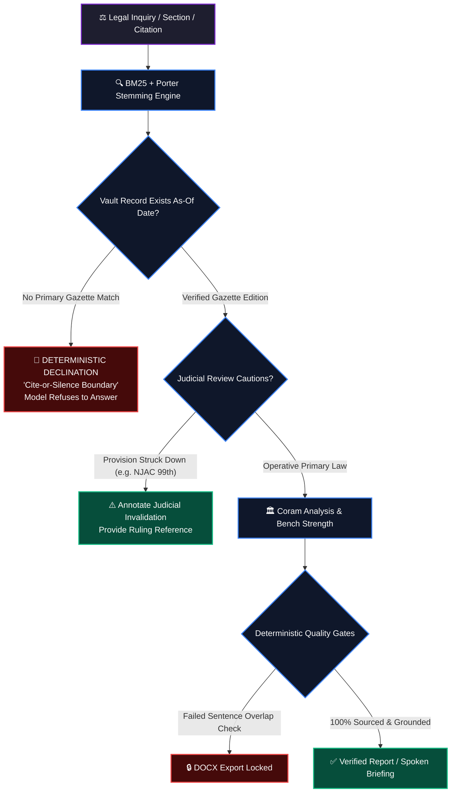

# AdvocateVox

```text
    ___    ____ _    ______  _________  ____________   _    ______  _  __
   /   |  / __ \ |  / / __ \/ ____/   |/_  __/ ____/  | |  / / __ \| |/ /
  / /| | / / / / | / / / / / /   / /| | / / / __/     | | / / / / /|   / 
 / ___ |/ /_/ /| |/ / /_/ / /___/ ___ |/ / / /___     | |/ / /_/ //   |  
/_/  |_/_____/ |___/\____/\____/_/  |_/_/ /_____/     |___/\____//_/|_|  
```

> ### *"Fiat Justitia, Ruat Caelum — In the sanctum of jurisprudence, an unverified citation is perjury; an invented precedent is an assault on justice. AdvocateVox stands upon an immutable canon: Cite or stay silent. Every clause traced to the Gazette, every holding bound to the coram, every word voiced in cryptographic truth."*

<div align="center">

[](LICENSE)
[](test/)
[](https://nodejs.org/)
[-FF6F00?style=for-the-badge&logo=npm&logoColor=white)](package.json)
[](#)
[](#narrator-preferences--neural-voice)

</div>

---

## 🏛️ 3D Architectural Topography & Depth Engineering

AdvocateVox is engineered with a **5-tier sovereign depth model**, isolating cryptographic provenance from inference surfaces to eradicate probabilistic hallucinations.

```text
                  _________________________________________________________
                 /                                                        /|
                /                     ADVOCATE VOX                       / |
               /           Voice-First Legal Intelligence Engine        /  |
              /________________________________________________________/   |
              |                                                        |   |
   LAYER 5    |   🎙️ NEURAL VOCALIZATION & PRACTICE SURFACES           |   |
  SURFACE     |   • Sarvam Bulbul v3 / Chatterbox / en-IN Native       |   |
              |   • Semantic Web Studio (/lawbuddy/teach)              |   |
              |   • Practice Workbench & Chamber Matter Intake         |   |
              |________________________________________________________|   |
              |                                                        |  /|
   LAYER 4    |   🛡️ DETERMINISTIC QUALITY GATES & REPORT COMPILER      | / |
  INTEGRITY   |   • Strict Sentence-Level Verification Matrix          |/  |
              |   • Court Document Packets (Bail, FIR, Adjournment)    |   |
              |   • Unalterable Word .DOCX Export Engine               |   |
              |________________________________________________________|   |
              |                                                        |  /|
   LAYER 3    |   ⚖️ PRECEDENT GRAPH & BENCH STRENGTH ENGINE           | / |
  JUDICIAL    |   • Coram Decomposition (Author vs Concur vs Dissent)  |/  |
              |   • SCR Normalization & Treatment Weighting Table      |   |
              |   • AWS Open Data Supreme Court Judgments Corpus       |   |
              |________________________________________________________|   |
              |                                                        |  /|
   LAYER 2    |   🔄 STATUTORY TEMPORAL MATRIX & TRANSITION BRIDGE     | / |
  TEMPORAL    |   • BNS ↔ IPC | BNSS ↔ CrPC | BSA ↔ Indian Evidence Act|/  |
              |   • Point-in-Time Provision History & Struck-Down Laws |   |
              |   • IT Act 2000 (§§ 43/66) & DPDP 2023 As-Of Slices    |   |
              |________________________________________________________|   |
              |                                                        |  /
   LAYER 1    |   📜 e-GAZETTE PROVENANCE & CRYPTOGRAPHIC FOUNDATION   | /
  FOUNDATION  |   • egazette.gov.in TLS Chain Completion Engine        |/
              |   • SHA-256 Content-Addressed Vault & FTS5 BM25 SQLite |
              |________________________________________________________|
```

---

## ⚡ The Sovereign Imperative: "Cite-or-Silence"

In modern litigation and legal scholarship, an inaccurate citation or hallucinated precedent is catastrophic. AdvocateVox fundamentally repudiates probabilistic guesswork through an unbending architecture:



1. **Deterministic Grounding**: Searches point-in-time statutory enactments (*Constitution of India, Bharatiya Nyaya Sanhita 2023, Bharatiya Nagarik Suraksha Sanhita 2023, Bharatiya Sakshya Adhiniyam 2023*) using native `node:sqlite` FTS5 with BM25 ranking.
2. **Zero-Hallucination Refusal**: If official gazetted text cannot be substantiated down to the specific section and paragraph for the requested timeline, AdvocateVox **declines to answer** rather than fabricating legal text.
3. **Invalidation Awareness**: Tracks provisions struck down by constitutional benches (e.g., the 99th Constitutional Amendment on NJAC) and alerts counsel before invalid authorities are relied upon.

---

## 💎 Core Architectural Engines

### 1. 📜 Cryptographic e-Gazette Vault & TLS Auto-Completion
Connecting to official portals such as `egazette.gov.in` frequently breaks automated pipelines due to broken or incomplete intermediate TLS certificate chains.
* **Autonomous AIA Resolution**: Reads `Authority Information Access` (AIA) extensions from the leaf certificate, recursively downloads missing intermediate issuer certificates over standard HTTP, and establishes a trusted cryptographic chain.
* **Content-Addressed Vault**: Every Gazette PDF and section-record is hashed via SHA-256 upon ingestion and sealed into SQLite immutable tables.

### 2. 🔄 Statutory Crosswalk & Transition Matrix
The transition from colonial-era criminal codes to contemporary enactments poses immense risk of miscitation. AdvocateVox provides high-precision bidirectional correspondence:
* **BNS ↔ IPC** (Bharatiya Nyaya Sanhita, 2023 ↔ Indian Penal Code, 1860)
* **BNSS ↔ CrPC** (Bharatiya Nagarik Suraksha Sanhita, 2023 ↔ Code of Criminal Procedure, 1973)
* **BSA ↔ IEA** (Bharatiya Sakshya Adhiniyam, 2023 ↔ Indian Evidence Act, 1872)

```text
┌─────────────────────────────────────────────────────────────────────────────┐
│ STATUTORY TRANSITION MATRIX                                                 │
├────────────────────┬────────────────────┬───────────────────────────────────┤
│ HISTORIC CODE      │ CONTEMPORARY CODE  │ LEGAL CHARACTER & CHANGE VECTOR   │
├────────────────────┼────────────────────┼───────────────────────────────────┤
│ IPC § 302 (Murder) │ BNS § 103(1)       │ Substantive penalty preserved     │
│ IPC § 420 (Cheat)  │ BNS § 318(4)       │ Restructured offence category     │
│ CrPC § 167 (Remand)│ BNSS § 187         │ Extended phased police custody    │
│ IEA § 65B (Electr.)│ BSA § 61           │ Certificate modernization & hash  │
└────────────────────┴────────────────────┴───────────────────────────────────┘
```

### 3. ⚖️ Precedent Citation Graph & Bench Strength Engine
Ingesting judgments from the Supreme Court of India collection on AWS Open Data:
* **Coram Anatomy**: Distinguishes the authoring judge, concurring brethren, and separate dissenting opinions line-by-line. Rulings quoted from a dissent cannot masquerade as the holding of the Court.
* **Bench Strength Weighting**: Automatically ranks decisions by coram size (Single Judge < Division Bench [2] < Full Bench [3] < Constitution Bench [5+] < Landmark Benches [7, 9, 13]).
* **Treatment Classification**: Identifies whether a cited precedent was *relied on*, *distinguished*, *overruled*, or *referred to* across the subsequent citation lattice.

### 4. 🎙️ Vocal Jurisprudence & Neural Voice Synthesis
AdvocateVox is built from the ground up for voice-first advocacy, oral submissions, and audible chamber review:
* **Sarvam AI Bulbul v3**: Deeply tuned for authentic Indian-English cadence, statutory pronunciation, and court terminology.
* **Chatterbox Engine**: Resilient server-narrator with zero-configuration device fallback.
* **Deterministic Bounds**: Hardware-accelerated local device speech ensures full privacy for confidential chamber matter intake when cloud dispatch is disallowed.

### 5. 🛡️ Practice Workbench & High-Assurance Chamber Intake
Located at `/lawbuddy/practice`, the workbench constructs structured litigation packets:
* **Matter Separation**: Keeps incident details, case station, filing forum, and jurisdiction strictly isolated.
* **Adverse Issue Flagging**: Warns counsel of jurisdictional bars, statutory limitation windows, and missing prerequisite facts.
* **Immutable Word `.docx` Production**: Prepared packets generate editable, structured Word documents with internal chamber review notes isolated on separate audit pages. Intake modifications automatically invalidate and lock export until re-verified.

### 6. 🌐 2026 Cyber & Special Instrument Matrix
Comprehensive indexing of India’s evolving technology laws:
* **Information Technology Act, 2000**: Sections 43 & 66 indexed against official India Code editions as on **27 June 2025**.
* **DPDP Act, 2023 & Rules**: Digital Personal Data Protection regulatory index with SPDI transition mechanics.
* **Subordinate Instruments**: CERT-In cyber security directions, Intermediary Guidelines (including notified 2026 amendments), Digital Evidence procedures, and Telecom regulatory instruments.

---

## 🚀 Interactive CLI Showcase

AdvocateVox ships with a hyper-fast terminal interface built on pure Node.js:

```text
╭─────────────────────────────────────────────────────────────────────────────╮
│ ADVOCATE VOX CLI                                                            │
╰─────────────────────────────────────────────────────────────────────────────╯

$ npm run cli -- search --act BNS --as-of 2024-07-01 "murder"

[GROUNDED RESULT]
 Act:        Bharatiya Nyaya Sanhita, 2023 (Act No. 45 of 2023)
 Provision:  Section 103(1) - Punishment for murder
 As-Of Date: 2024-07-01 (Commencement: 2024-07-01)
 SHA-256:    e3b0c44298fc1c149afbf4c8996fb92427ae41e4649b934ca495991b7852b855
 Provenance: egazette.gov.in / Content-Addressed Vault
 
 Snippet:
 "Whoever commits murder shall be punished with death or imprisonment for
  life, and shall also be liable to fine..."
 ---------------------------------------------------------------------------
 Historical Crosswalk: IPC § 302 -> BNS § 103(1)
 Judicial Cautions:    No invalidating constitutional judgements recorded.
```

### Essential CLI Operations

```bash
# 1. Search grounded provisions with BM25 ranking
npm run cli -- search "right to education"

# 2. Date-bound point-in-time statutory inquiry
npm run cli -- search --act BNS --as-of 2024-07-01 "culpable homicide"

# 3. Explore Indian instrument catalog & indexing status
npm run cli -- catalog "DPDP Rules"

# 4. Instant code crosswalk lookup
npm run cli -- lookup IPC 302
npm run cli -- lookup CrPC 167

# 5. Check Bare Act copy against official Gazette
npm run cli -- check-copy https://example.org/bare-act-draft.pdf

# 6. Cryptographically import official document
npm run cli -- import <local-pdf> <official-source-url>
```

---

## 🛠️ Sovereign Architecture (Zero External Dependencies)

AdvocateVox is engineered with uncompromising minimalism. No bloated external npm libraries; no volatile supply chain attack surface.

```text
┌─────────────────────────────────────────────────────────────────────────────┐
│ RUNTIME ARCHITECTURE                                                        │
├─────────────────────┬──────────────────┬────────────────────────────────────┤
│ COMPONENT           │ ENGINE           │ PURPOSE                            │
├─────────────────────┼──────────────────┼────────────────────────────────────┤
│ Database & FTS      │ node:sqlite      │ Embedded FTS5 BM25 search & store  │
│ Network Server      │ node:http        │ High-throughput HTTP API server    │
│ Cryptography        │ node:crypto      │ SHA-256 hashing & TLS chain repair │
│ File System         │ node:fs          │ Asynchronous disk I/O & vault      │
│ Test Harness        │ node:test        │ 201 native unit & integration tests│
│ Layout Extraction   │ Python 3.10+     │ pdfplumber==0.11.4 isolated worker │
│ Web Security        │ Hardened CSP     │ Zero inline scripts, no innerHTML  │
└─────────────────────┴──────────────────┴────────────────────────────────────┘
```

---

## 🏁 Quick Start & Installation

### Prerequisites

* **Node.js** >= `22.0.0` (Native `node:sqlite` and built-in test runner)
* **Python** >= `3.10` (Isolated worker for high-fidelity PDF layout extraction)

### 1. Clone & Initialize Environment

```bash
# Clone the repository
git clone https://github.com/your-org/advocatevox.git
cd advocatevox

# Configure environment variables
cp .env.example .env
```

### 2. Prepare Python PDF Layout Worker

```bash
python3 -m venv workers/.venv
workers/.venv/bin/pip install -r workers/requirements.txt
```

### 3. Install & Verify Integrity

```bash
# Zero third-party runtime dependencies
npm install

# Execute the complete test suite (201 tests across the entire stack)
npm test
```

### 4. Launch the Chamber Studio

```bash
npm run dev
```

The web studio will initialize with strict security headers at:
* **Interactive Legal Tutor**: `http://localhost:3000/lawbuddy/teach`
* **Practice Workbench**: `http://localhost:3000/lawbuddy/practice`
* **Autonomous Legal Reports**: `http://localhost:3000/lawbuddy/reports`
* **Instrument Catalog**: `http://localhost:3000/lawbuddy`

---

## 🎙️ Narrator Preferences & Neural Voice

AdvocateVox provides three layers of speech output:
1. **Cloud Indian-English Neural TTS (Sarvam Bulbul v3)**:
   * Provides `Ishita` and `Ratan` vocal profiles.
   * Configure `SARVAM_API_KEY` in your `.env`.
   * Requires explicit user consent before streaming text upstream.
2. **Chatterbox Server Narrator**: Automatic fallback with calibrated cadence.
3. **Hardware Device Voices**: Priority matching for installed `en-IN` system voices for offline confidential review.

---

## 📦 Integration with DocVex

AdvocateVox exposes clean modular integration primitives for the `@docvex/lawbuddy` package:

```javascript
import {
  handleLawBuddyStaticRoute,
  handleLawBuddyApiRoute,
  createLawRetriever,
  createLegalStoreLoader,
  LAWBUDDY_FILES,
  LAWBUDDY_SECURITY_HEADERS
} from '@docvex/lawbuddy';

// Mount API and static routes within your sovereign application
```

---

## 📚 Technical Documentation Directory

| Document | Description |
| :--- | :--- |
| [Legal Library Architecture](docs/LEGAL_LIBRARY_ARCHITECTURE.md) | Ingestion gates, versioning invariants, and cyber import roadmap |
| [Reports Repair & Verification](docs/REPORTS_REPAIR.md) | Deterministic quote cards, model gates, and .DOCX serialization |
| [Practice Workbench Protocol](docs/PRACTICE_WORKBENCH.md) | Intake partitioning, jurisdiction bounds, and matter structuring |
| [Drafting & Jurisdiction Matrix](docs/DRAFTING_ARCHITECTURE.md) | High Court & District Court templates and procedural schemas |
| [Indexing & Voice Synthesis Plan](docs/INDEXING_AND_VOICE_PLAN.md) | Sarvam Bulbul v3 integration and audio caching topology |
| [Teach Me Failure Modes](docs/TEACH_ME_FAILURE_MODES.md) | Incident review of semantic retrieval and assurance safeguards |
| [Indexing Backlog & Status](docs/INDEXING_BACKLOG.md) | Tracking state enactments, subordinate rules, and missing editions |
| [2026 Strategic Priorities](docs/PRIORITIES_2026.md) | Next-generation court automation, appellate graphs, and legal RAG |

---

## ⚖️ License & Provenance Notice

Distributed under the **MIT License**. See `LICENSE` for details.

> *Disclaimer: AdvocateVox is an educational and professional legal engineering research engine. While grounded strictly in verified primary gazetted texts and judicial records, automated outputs do not constitute formal legal counsel. Always verify with official Government of India Gazettes and certified Court registries.*
