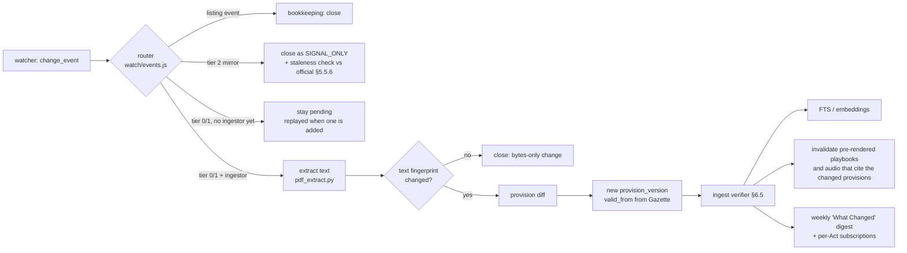

# LawBuddy × DocVex — Research-Backed Implementation Plan

> **One line:** LawBuddy is a voice-first legal tutor that teaches Indian case law, statutes and amendments **only from primary sources it has fetched and checked itself**. It cites every claim down to the paragraph and says "I couldn't verify that" rather than guessing.

Status: Draft v1.7 (case-law layer live: 38,371 Supreme Court judgments indexed, precedent points with cited-by counts, overruled status from the reporter's own treatment labels, quote-verified and opinion-attributed briefs, verified-only reviews) · 2026-10-14 · Owner: @harshakumar25
Builds on: DocVex runtime (`server/`, `extension/`, `demo.html`)

---

## 0. TL;DR

| | Decision |
|---|---|
| **Product** | **LawBuddy website** (hosted), with DocVex as its voice/teaching engine |
| **Who first** | **Judiciary aspirants (PCS-J) and LLB students**, mostly students. **Lawyers use it for revision.** Each case is offered as a **short summary** or a **full case study**. Citizens' "Know Your Rights" comes in Phase 5. |
| **Models** | **Groq** for runtime teaching and voice (fast first sentence). **Claude** for ingest-time Case Record extraction and verification. The model adapter is provider-neutral, so OpenAI (Codex/GPT) can be plugged in later. |
| **First niche** | **Indian Constitution**: a bounded official text, a limited set of landmark Supreme Court cases, heavy weight in judiciary and LLB papers, and the Supreme Court is its final interpreter. |
| **Then** | Criminal major acts (IPC→BNS/BNSS/BSA) → Civil core for judiciary (CPC, Contract, TPA, Specific Relief, Limitation) → Company law / IBC / SEBI → others |
| **Core idea** | Do the hard thinking when a judgment is ingested, not when the user asks. Every judgment becomes a **verified Case Record** (facts, issues, holding, ratio), each item pinned to paragraph numbers. At question time the model only *teaches from* these records. |
| **Anti-hallucination contract** | **Cite-or-Silence**: no paragraph, no claim. Every generated claim is checked after generation before it is spoken. |
| **Data** | Official/primary sources through scheduled connectors (SC, HCs via AWS Open Data, India Code, e-Gazette, legislative.gov.in, SEBI RSS, MCA, NCLAT). News sites are used only as alerts that trigger a fetch from the primary source. |
| **Storage (MVP)** | `node:sqlite` (built into Node 24, so no new npm deps, in keeping with DocVex) + FTS5/BM25, plus embeddings for the curated set. FTS5 + `bm25()` checked working on this machine's Node v24.11.1; the module still prints an ExperimentalWarning, so keep it behind `store/db.js`. Move to Postgres + pgvector when we scale. |
| **Success gate** | ≥99% citation validity, ≤2% unsupported claims, and 100% refusal on "fake-case trap" questions, measured on our own gold set before every release. |

---

## 1. The problem, restated precisely

You listed 9 problems. They reduce to **four root causes**:

| # | Your problem | Root cause | LawBuddy fix (section) |
|---|---|---|---|
| 1 | Unfair or inaccurate answers, hallucinations | Model answers from memory, not from the source | Cite-or-Silence pipeline (§6) |
| 2 | Facts unclear because GPT can't fetch the case | No access to the judgment text | Own corpus + direct connectors (§4, §5) |
| 3 | Citations are easy to forget, yet they are the "legal footprint" | Citations are treated as text, not as data | Citation as a first-class entity + Citation Drill (§5.3, §7) |
| 4 | Not every case is on third-party apps | Dependence on aggregators | Primary-source pipelines + a coverage dashboard that shows gaps (§4) |
| 5 | Needs explanation "in the legal sense" | Generic chatbot pedagogy | FIRAC + ratio/obiter + precedent hierarchy teaching templates (§7) |
| 6 | Users don't trust it, and AI doesn't have every answer | No transparency, no limits | Show the paragraph, a "verified" badge, confidence, and a referral when out of scope (§6.5, §9) |
| 7 | Not updated with new cases, laws, amendments | Training cutoff | Daily sync + temporal (point-in-time) statute model (§5.4) |
| 8 | Similar articles fool the AI | No entity resolution, no source tiering | Source tiers + case disambiguation + good-law status (§5.2, §6.2) |
| 9 | Citizens don't know which laws protect them | Law is organised by statute, people think by situation | Situation-first "Know Your Rights" playbooks (§8) |

### Why this matters now (evidence)

- **Even legal-specific AI hallucinates.** Stanford/Yale's preregistered study found Lexis+ AI and Westlaw AI-Assisted Research hallucinated **17–33%** of the time, and GPT-4 without retrieval did worse. They also found that **40–50% of hallucinations start with retrieval failures**. [Magesh et al., 2024/2025](https://dho.stanford.edu/wp-content/uploads/Legal_RAG_Hallucinations.pdf)
- **Retrieval alone isn't enough.** In one 2026 study, turning off the post-generation validation layer left retrieval accuracy at 99.1% but cut citation validity to 12.3%. [CiteGuard-RAG](https://arxiv.org/pdf/2609.15830)
- **Indian courts are already penalising AI fake citations.** Examples: Delhi HC in *Greenopolis Welfare Association v. Narender Singh* (2025, non-existent precedents); the Supreme Court's reported reaction to a trial court relying on four non-existent "judgments"; a reported Bombay HC quashing of a ~₹28-crore assessment built on invented precedents; a reported ITAT Bengaluru recall. [iPleaders summary](https://blog.ipleaders.in/ai-hallucinated-case-law-fake-citations-india/), [FPJ](https://www.freepressjournal.in/amp/mumbai/ai-generated-fake-judgments-under-fire-as-supreme-court-bombay-hc-warn-lawyers). *(Verify each against the order text before quoting in marketing.)*
- **Courts are setting verification norms.** Kerala HC's July 2025 AI policy for the district judiciary requires human verification of every citation and translation, plus audit logs. [SpicyIP](https://spicyip.com/2025/08/bench-and-bot-the-kerala-hcs-ai-guidelines-and-the-bigger-judicial-puzzle.html)
- **Judgments are huge.** NJAC ~1,042 pages, Aadhaar (Puttaswamy) ~1,448, Kesavananda ~2,100. Students do not read these. [National Herald](https://www.nationalheraldindia.com/amp/story/opinion/lengthy-judgments-are-not-only-counter-productive-they-are-hazardous-too)
- **Free access matters.** Delhi HC noted that most legal professionals cannot afford paid databases and rely on free portals. [Bar & Bench](https://www.barandbench.com/news/litigation/most-lawyers-cant-afford-paid-legal-databases-delhi-hc-in-indian-kanoon-right-to-be-forgotten-case)

**Positioning:** Even the best tools sit at 17%+ hallucination. In law, being *correct and verifiable* is what wins. Being "smart" is not enough.

---

## 2. Competitive landscape: what's broken in existing products

| Product | Strength | Gap LawBuddy exploits |
|---|---|---|
| **Indian Kanoon** | Free, huge coverage, has an API | No automated *overruled/good-law* flag (you audit "Cited by" manually); texts not always authenticated; search-first, not teaching-first. [Jurigram](https://jurigram.com/advocates/resources/legal-research/how-to-find-overruled-judgments-on-indian-kanoon) |
| **SCC Online / Manupatra** | Citators with overruled flags, editorial headnotes | Expensive. Built for practitioners, not learners. Headnotes are copyrighted editorial work, so we cannot reuse them. |
| **CaseMine / AMICUS** | Gen-AI answers with sources, precedent maps | Lawyer and research workflow. Not exam pedagogy. Not voice. [Bar & Bench](https://www.barandbench.com/news/casemine-launches-ai-powered-legal-assistant-amicus) |
| **Jurisphere, Lucio etc.** | Contract drafting/review for firms | Different segment, B2B. [Global Legal Post](https://www.globallegalpost.com/news/indian-legal-ai-platform-start-up-jurisphere-raises-22m-in-funding-round-1120556859) |
| **LiveLaw / Bar & Bench** | Fast news | Paywall after 30 days (LiveLaw). News, not structured learning. [Wikipedia](https://en.wikipedia.org/wiki/Live_Law) |
| **Coaching PDFs / monthly digests** | Exam-focused | Static, unverifiable, stale within weeks, no citations to paragraphs |
| **ChatGPT-style chatbots** | Fluent | General models hallucinated 58–88% on legal queries ("Large Legal Fictions", Stanford 2024). No live corpus. |

**The gap no one fills:** *a free or low-cost tutor that teaches by voice, verifies every citation to the paragraph, stays current every day, knows whether a case is still good law, works in Hindi and English, and drills citations until you remember them.*

---

## 3. Legal & compliance guardrails (decide before writing code)

| Area | Rule | Implementation consequence |
|---|---|---|
| **Copyright in judgments** | Copyright Act 1957 **s.52(1)(q)**: reproducing judgments/orders is not infringement. *Eastern Book Co. v. D.B. Modak* (2008) 1 SCC 1: raw judgment text is free to reproduce, but a publisher's **original editorial inputs (headnotes etc.) can be protected**. [Law and Other Things](https://lawandotherthings.com/are-indian-court-judgments/) | Ingest from official sources and AWS Open Data. **Never** copy SCC/Manupatra headnotes or paragraph formatting. Generate our own summaries. Store "reporter citations" (e.g., "(2017) 10 SCC 1") as *identifiers only*. |
| **News sites** | Articles are copyrighted | Store only title + URL + date as an *alert*. Fetch the primary judgment and teach from that. |
| **Site terms & CAPTCHAs** | eCourts portals use CAPTCHAs and have no official bulk API. [Search notes](https://pypi.org/project/bharat-courts/0.3.1/) | **Do not automate CAPTCHAs or bulk-scrape portals.** Use the AWS Open Data mirrors for bulk and official RSS/listing pages politely (robots.txt, ≤1 request every few seconds, conditional GET). Indian Kanoon's API is **not** used (decision 2026-10-12). |
| **Unauthorised practice / BCI** | Advocates Act 1961 + BCI Rule 36 restrict practice and solicitation. BCI has acted against platforms listing lawyers. [Medianama](https://www.medianama.com/2025/03/223-the-bar-council-of-india-warns-against-legal-advertising-online/) | LawBuddy provides **legal information and education, not legal advice**. No lawyer marketplace or ads. Citizen mode always ends with the free legal aid route (NALSA / State LSA / Tele-Law). Get a written opinion from counsel before the citizen launch. |
| **Data protection** | DPDP Rules notified 13–14 Nov 2025. Consent managers ~Nov 2026. Core consent, notice, security and **children's data** duties apply from ~May 2027. [Mondaq](https://www.mondaq.com/india/data-protection/1708164/digital-personal-data-protection-rules-2025-notified) | CLAT UG aspirants can be <18, so build verifiable parental consent before onboarding minors. Keep the local-first default (DocVex already does). Minimise data. Plan a 72-hour breach report process. |
| **Victim identity** | Courts and statute bar disclosing identities of sexual-offence victims (BNS s.72 / former IPC s.228A) | A redaction pass at ingest: never voice or display a victim name. Respect court-ordered anonymisation and right-to-be-forgotten takedowns. |
| **Dataset licences** | AWS Open Data SC/HC judgments are **CC-BY-4.0** | Attribution line in the app's footer and About page. |

---

## 4. Source map: the pipelines

**Source tiers** decide what may count as *evidence*:

- **Tier 0, Primary official:** judgment PDFs from the court, Gazette, India Code, legislative.gov.in. *Can be cited.*
- **Tier 1, Official mirror/secondary:** AWS Open Data mirror, SUVAS translations. *Can be cited, but the record links back to the Tier 0 URL where available.*
- **Tier 2, Signal only:** LiveLaw, Bar & Bench, SC Observer, PIB. *Never cited as law. Only triggers a Tier 0/1 fetch.*
- **Tier X, Banned as evidence:** blogs, coaching notes, forums, unofficial "IPC→BNS tables".

| Source | What we get | Access method | Cadence | Tier |
|---|---|---|---|---|
| **AWS Open Data: Indian Supreme Court Judgments** | ~35K SC judgments 1950→present, PDFs + JSON/parquet metadata, regional-language versions | `aws s3 ls --no-sign-request s3://indian-supreme-court-judgments/` (ap-south-1), CC-BY-4.0. [Registry](https://registry.opendata.aws/indian-supreme-court-judgments/) | Upstream updates bi-monthly; we sync weekly | 1 |
| **AWS Open Data: Indian High Court Judgments** | 25 HCs, PDFs + metadata | `s3://indian-high-court-judgments/`. [Registry](https://registry.opendata.aws/indian-high-court-judgments/) | Quarterly upstream | 1 |
| **Supreme Court website (sci.gov.in)** | Freshest judgments, **neutral citations** (`2023 INSC 1` format, from 6 Jul 2023; back-assigned 2014–2023). [SC notice](https://main.sci.gov.in/pdf/LU/27042023_135802.pdf) | Polite daily fetch of the public judgments listing → PDF | Daily | 0 |
| **e-SCR (Digital Supreme Court Reports)** | Official SCR 1950→, free; free-text/judge/bench search. [Verdictum](https://www.verdictum.in/court-updates/supreme-court/e-scr-free-access-to-34000-judgments-1455548) | Link-out + reference IDs (SCR citations) | — | 0 |
| **SUVAS translations** | 51,501 translated SC judgments in 18 languages (Hindi 36,260) as of Jul 2024. [Lok Sabha reply](https://eparlib.nic.in/bitstream/123456789/2980996/1/AS77_V3ORN5.pdf) | Via e-SCR/AWS regional versions | Weekly | 1 |
| ~~Indian Kanoon API~~ | **Not used (decision 2026-10-12).** HC freshness gaps between quarterly AWS updates are filled from individual High Court websites' public judgment listings, fetched politely and without CAPTCHAs. | — | — | — |
| **India Code (indiacode.nic.in)** | All central + state Acts, subordinate legislation, footnotes (amendment history). Hindi lags English. [About](https://www.indiacode.nic.in/about.jsp?locale=en) | Polite fetch per Act + section | Weekly diff | 0 |
| **legislative.gov.in** | Constitution of India, official updated text: **"The Constitution of India 2026 (English Version)"**, published 12 Jun 2026, 2.56 MB, plus a Hindi–English diglot (17 Jun 2026, 9.12 MB). Also amendment Acts and translations. [Listing](https://www.legislative.gov.in/documents/constitution-of-india/constitution-of-india-AjN2EjMtQWa?pageTitle=Constitution-of-India) · [English PDF](https://www.legislative.gov.in/static/uploads/2025/07/c9fe9c9b6840524844316f74bb1c556c.pdf). (The 2024 edition at lddashboard.legislative.gov.in is superseded and that host times out.) | Fetch + watch the "amendment acts" listing | Weekly | 0 |
| **e-Gazette (egazette.gov.in)** | Every notification (commencement dates, rules, ordinances). IDs like `CG-DL-E-29062026-273926` | Poll the recent-gazette listing, filter by ministry/keyword (Acts, Ordinance, Rules) | Daily | 0 |
| **NCRB Sankalan (MHA)** | Official compilation of BNS/BNSS/BSA: Gazette copies of the three Acts, commencement notifications, chapter/section pages, and **Corresponding Section Tables BNS↔IPC, BNSS↔CrPC, BSA↔IEA** (HTML). [Portal](https://www.ncrb.gov.in/uploads/SankalanPortal/Index.html) | robots.txt `Disallow: /`, so **manual import only** (`npm run legal -- import-table`) | On change (rare) | 0 |
| **SEBI** | Circulars, master circulars, orders | **Official RSS: `https://www.sebi.gov.in/sebirss.xml`** [SEBI RSS](https://www.sebi.gov.in/rss.html) | Hourly | 0 |
| **MCA (mca.gov.in)** | Companies Act rules and notifications (e.g., 2026 amendment rules) | Poll the notifications listing + Gazette cross-check | Daily | 0 |
| **NCLAT / NCLT (via IBBI)** | Tribunal orders (company/IBC) | NCLAT daily-order listing; IBBI NCLT order mirror | Daily | 0 |
| **Law Commission reports, PIB** | Context, reform background | Listing poll | Weekly | 0 / 2 |
| **LiveLaw, Bar & Bench, SC Observer** | "Something important happened" | RSS/headlines → **alert only** → resolve to a primary judgment | Hourly | 2 |
| **yourlordships.in/bare-acts** (judiciary coaching site) | 19 bare-act PDFs a coaching institute treats as core for judiciary prep (list in §11d) | **Watched automatically** (robots allows all; strong ETag/Last-Modified on every PDF, so revalidation is a bodiless 304) → **signal + curriculum only** | Listing 12 h–7 d, PDFs 1–30 d (adaptive) | 2 |

**Observed access for our declared bot (`LawBuddyBot/0.1`), tested 2026-10-12 from an Indian IP:**

| Source | Result | Route |
|---|---|---|
| AWS Open Data SC/HC buckets | ✅ 200 | Automatic (the bulk backbone) |
| SEBI RSS (`sebirss.xml`) | ✅ 200, then 304 on revalidation | Automatic |
| sci.gov.in, indiacode.nic.in, legislative.gov.in | ❌ 403 from the Akamai firewall for our bot user-agent (a generic curl user-agent gets 200) | **Manual import** (`npm run legal -- import <file> <url>`) + ask NIC / the Legislative Department for whitelisting or official bulk access |
| lddashboard.legislative.gov.in | ❌ connection timeout | Manual import |
| egazette.gov.in | ✅ GET 200 for our bot; no robots.txt (404 = no restrictions). Two traps: **every HEAD request returns 404** (server quirk, so probe with GET), and the server sends an **incomplete TLS chain** (leaf only, issued by Let's Encrypt YR2 → ISRG Root YR, cross-signed by ISRG Root X1). Node fails where curl succeeds; LawBuddy now completes the chain the way browsers do (§5.5.7) | Automatic, tier 0. BNS (CG-DL-E-25122023-250883), BNSS (…250884), BSA (…250882) Gazette PDFs fetched 2026-10-12 |
| yourlordships.in | ✅ 200; robots.txt `Disallow:` (allow all); listing page byte-stable; all 19 PDFs carry `ETag` + `Last-Modified` (every one **28 Dec 2023**), 15.8 MB total | Automatic, via the watch pipeline (§5.5); tier 2 |

**Policy:** we never disguise the user-agent or otherwise get around a bot block. Blocked sources are handled by a person downloading in a browser (recorded as `method = 'manual'` with the original URL and sha256) until the publisher grants access.

**Coverage dashboard (fixes problem #4):** the Admin console shows, per court and year, *how many judgments we have vs. expected*, the last sync time, and failed fetches. Gaps become visible instead of silently missing.

---

## 5. Architecture

### 5.1 Where LawBuddy plugs into DocVex

```mermaid
flowchart TD
  subgraph Ingest["LawBuddy Ingestion (scheduled workers)"]
    C1[Connectors: AWS SC/HC · sci.gov.in · HC sites · India Code · Gazette · SEBI RSS · MCA · NCLAT]
    C1 --> R[Raw Vault: immutable PDFs/HTML, sha256, fetch log]
    R --> X[Extract: PDF→text with page + para numbers; OCR fallback incl. Hindi]
    X --> P[Parse: parties, court, bench, date, case no., neutral & reporter citations, statutes cited]
    P --> E[Enrich (strong LLM, offline): Facts / Issues / Holding / Ratio / Obiter, every item → para ids]
    E --> V1[Ingest Verifier: quoted spans must exist; para ids valid; schema strict]
    V1 --> G[Citation Graph: cites / cited-by / overruled / distinguished / referred to larger bench]
    G --> IDX[Index: FTS5 BM25 + embeddings; Case Records; Provision versions]
  end

  subgraph Runtime["DocVex Runtime (existing, extended)"]
    U[Extension highlight · Dashboard · Docy voice question] --> RI{decideRetrievalPath}
    RI -->|legal| LR[Legal Retriever: resolve → hybrid search → good-law filter]
    LR --> TP[teacherPrompt · LAW MODE (FIRAC, spoken citations)]
    TP --> LLM[Groq / Ollama / hybrid]
    LLM --> V2[Answer Verifier: claim→para support, citation exists, status check]
    V2 -->|pass| SB[SentenceBuffer → speechNormalization (legal) → TTS]
    V2 -->|fail| RF[Refuse / downgrade: 'I couldn't verify this from the judgment']
  end
  IDX --> LR
```

**Key engineering choice:** *shift intelligence to ingest time.* A strong model plus a verifier builds each Case Record once (it can be slow, and it is cached and reviewable). The runtime model, even DocVex's small local `qwen3:4b`, then only has to **teach from verified structured facts**. That protects both accuracy and DocVex's <600 ms first-sentence target.

### 5.2 Repo layout (proposed)

```
server/legal/
  sources/registry.js         # source tiers, domains, cadence, robots policy
  connectors/                 # one file per source; all share fetchPolitely()
    awsScJudgments.js  sciDaily.js  indiaCode.js  egazette.js
    sebiRss.js  mcaNotifications.js  nclatOrders.js  highCourtListings.js
  store/db.js                 # node:sqlite (built-in, Node 24) + FTS5; migrations
  store/schema.sql
  parse/citationParser.js     # INSC / SCC / AIR / SCR / SCALE / HC neutral formats
  parse/caseMetadata.js       # parties, bench, dates, case numbers
  parse/paragraphs.js         # stable para ids ("2017INSC1#p143")
  enrich/caseRecord.js        # LLM extraction → strict JSON with para refs
  verify/ingestVerifier.js    # span-exists, schema, para-range checks
  verify/answerVerifier.js    # runtime claim support + citation existence + status
  graph/treatment.js          # overruled/distinguished/per incuriam detection
  retrieval/legalRetriever.js # resolve → hybrid → rerank(optional) → filter
  study/                      # FIRAC playbooks, citation drill (FSRS), roadmaps
  jobs/scheduler.js           # setInterval/cron-like loop, job locks, backoff
workers/pdf_extract.py        # PyMuPDF/pdfplumber + Tesseract (eng+hin), like chatterbox/docvex_worker.py
```

*As built:* the code lives in the `@docvex/lawbuddy` workspace package, `packages/lawbuddy/src/` (`sources/`, `store/`, `parse/`, `extract/`, `ingest/`, `retrieval/`, `watch/`), with tests in `packages/lawbuddy/test/`. Backlog rows below that say `server/legal/…` refer to the same files before the monorepo move.

It follows existing DocVex rules (`.agents/rules/docvex_engineering_rules.md`): Node built-ins, no fake implementations, `<evidence>` containment, explicit `groundingStatus`.

### 5.3 Data model (core tables)

```
source(id, name, tier, base_url, cadence, last_success_at)
fetch_log(id, source_id, url, http_status, sha256, fetched_at, etag, error)
document(id, source_id, url, sha256, mime, lang, raw_path, text_path)

case(id, court, bench_strength, judges[], decided_on, case_no, title,
     petitioner, respondent, neutral_cite, status ENUM(good|caution|overruled|unknown),
     document_id, translation_doc_ids[])
citation_alias(case_id, scheme ENUM(INSC|SCC|AIR|SCR|SCALE|HC_NEUTRAL|IK|OTHER), value, normalized)
paragraph(id "<case>#p<n>", case_id, n, page, text, role ENUM(facts|issue|arg_pet|arg_resp|analysis|ratio|obiter|order|unknown))
case_record(case_id, facts[], issues[], holding, ratio[], obiter[], each item {text, para_ids[]},
            generated_by, verified_by ENUM(machine|human), verified_at, version)
treatment(citing_case_id, cited_case_id, kind ENUM(followed|distinguished|overruled|doubted|referred|per_incuriam), para_id, confidence)

act(id, short_title, number, year, ministry)
provision(id, act_id, label "s.103" / "Art.21", heading)
provision_version(id, provision_id, text, valid_from, valid_to, amended_by_ref, gazette_ref)
mapping(old_provision_id, new_provision_id, kind ENUM(same|split|merged|new|deleted), verified_against_gazette BOOL)

study_card(id, user_id, case_id|provision_id, kind ENUM(citation|ratio|section), fsrs_state, due_at)
```

**Citation as a first-class entity (problem #3):** a case is one ID with many aliases (`2017 INSC ...`, `(2017) 10 SCC 1`, `AIR 2017 SC 4161`). The resolver normalises any of them, so users can type whatever their textbook used.

### 5.4 Temporal statutes (problem #7)

Law changes over time. Every provision has **versions with `valid_from`/`valid_to`** sourced from Gazette notifications. That enables:

- *"What did s.X say on the date of the offence?"* For example, offences on or before 30 Jun 2024 fall under the IPC and offences on or after 1 Jul 2024 under the BNS.
- An **amendment timeline** per provision, so students can hear "this changed in 2023 because…".
- The **IPC↔BNS / CrPC↔BNSS / IEA↔BSA mapping** comes from **MHA/NCRB's official Sankalan Corresponding Section Tables**, not from blogs. Published third-party tables *disagree* (notably in the sexual-offences chapter). [LawSikho](https://lawsikho.com/blog/ipc-to-bns-conversion) The official table marks each row as changed, new, deleted or merged, down to clause level (e.g. IEA 65B(3)(a) deleted). Stored in `provision_mapping` with source URL + sha256. Rows the parser can't read are surfaced for human review, never guessed.
- **Trap the mapping prevents:** BNS s.302 ("wounding religious feelings", ex-IPC 298) is *not* IPC s.302 (murder → BNS s.103).
- **State amendments vary the text by state.** Criminal law is on the Concurrent List. Maharashtra's BNS amendment (ss.72, 75) passed both Houses on 25 Mar 2026, and Tamil Nadu's Bill 2 of 2025 amends s.64 (assent status of both unverified). So `provision_version` needs a `jurisdiction` column (central vs state) before criminal-law ingest. Planned as a later migration.

### 5.5 Change-watch pipeline: fetch whenever a source updates (problem #7)

**Goal.** Every new, updated or withdrawn legal document should reach LawBuddy within its source's cadence. Checking must be nearly free when nothing changed, nothing may be missed, and every byte must keep its provenance. A changed PDF must never silently change what LawBuddy teaches without passing the same verification as the first ingest.

#### 5.5.1 Where changes first appear (watch these first)

Law changes in a fixed order. The pipeline watches the earliest official signal, not the last copy to be updated:

| Order | Where the change appears | Lag behind the law | LawBuddy role |
|---|---|---|---|
| 1 | **e-Gazette**: amendment Act, commencement notification, ordinance, rules | 0 (this *is* the law) | Tier 0 trigger: creates `provision_version` rows with `valid_from` |
| 2 | **legislative.gov.in**: updated Constitution editions, amendment Acts | Days to months | Tier 0 consolidated text (manual import while our bot is blocked) |
| 3 | **India Code**: consolidated Acts with amendment footnotes | Weeks to months (Hindi lags further) | Tier 0 consolidated text (manual while blocked) |
| 4 | **Court sites / AWS Open Data**: judgments interpreting the change | Daily (SC) to quarterly (AWS HC mirror) | Tier 0/1 evidence |
| 5 | **Mirrors** (coaching sites, blogs) | Months to **never**. yourlordships.in still serves its 28 Dec 2023 uploads | Tier 2 signal only, plus the **staleness detector** (§5.5.6) |

#### 5.5.2 Detection primitives (cheapest first)

| Primitive | Cost when nothing changed | Used for | Status |
|---|---|---|---|
| **Listing link-set diff**: compare the set of document links a page offers, not its bytes | One page GET (or a 304) | New, removed or returning documents on index pages | ✅ `watch/watcher.js` |
| **Conditional GET**: `If-None-Match` / `If-Modified-Since` → `304 Not Modified` | Headers only, no body | Every document on servers with validators (yourlordships: all 19 PDFs) | ✅ `sources/fetcher.js` |
| **sha256 content addressing**: the vault stores each version once and never overwrites | A full download, then a hash compare | Servers without validators; tamper evidence; full version history | ✅ `sources/vault.js` |
| **Per-item validators inside a listing**: S3 `ListObjectsV2` (ETag + LastModified per key), RSS `guid`/`pubDate`, sitemap `lastmod` | One listing call covers thousands of files | AWS SC/HC buckets, SEBI RSS, Gazette listings | ⏳ next: a `validators` hook per watchlist, so unchanged items are skipped without being requested |
| **Text fingerprint**: hash of normalised extracted text (whitespace and Unicode form only; words, punctuation and case still count) | A local re-extract, cached per sha256 | Closing byte-only changes (new PDF producer, timestamps, re-saves) before any check or ingest | ✅ `compare/textFingerprint.js`, migration 9 |
| **Copy-vs-official alignment**: locate each official provision in a copy by 5-gram voting, align word by word (LCS), report coverage and missing phrases | Local | "Is my bare act current?" for mirror copies and student uploads (§5.5.6) | ✅ `compare/copyCheck.js`, `compare/checkCopy.js` |
| **Provision diff**: section-by-section comparison of old and new text | Local | Turning "the PDF changed" into "s.106(2) changed; 357 sections unchanged" | ⏳ after the BNS/BSA section parser (backlog 9) |

#### 5.5.3 Target lifecycle

```mermaid
stateDiagram-v2
    [*] --> active: seeded listing / link discovered
    active --> active: 200 changed → event + interval = min
    active --> active: 304 or same sha → interval ×1.5 (≤ max)
    active --> active: 5xx / timeout / robots → interval ×2, failures+1
    active --> paused: HTTP 403 (bot blocked) → event; a person decides (manual import / ask the publisher)
    active --> gone: 404/410 three times in a row → event
    active --> gone: link removed from its listing → 'removed' event
    gone --> active: link reappears on the listing → 'restored' event
    paused --> active: a person re-enables it
```



- **Adaptive cadence** (`watch/cadence.js`): reset to the minimum on change (corrigenda and re-uploads cluster), back off ×1.5 while stable, ×2 on failure, then ±10% jitter so targets seeded together don't fire together. Bounds are set per watchlist.
- **Leases**: `claimDueWatchTargets` leases rows atomically (`UPDATE … RETURNING`), so two watcher processes never check one URL at the same time, and a crashed watcher's lease simply expires (10 min).
- **Stale-claim guard**: each target's state is re-read just before checking it, because a listing checked earlier in the same batch may have retired it. A test caught this bug during the build.
- **Politeness is inherited**: every watch request goes through the polite fetcher, so the registered-host check, robots.txt and Crawl-delay, per-host queue, size and time caps and the "no CAPTCHA, no bot-block evasion" rule all apply automatically.

#### 5.5.4 From change to lesson: the event pipeline



Rules:
1. **A change never edits law text in place.** It adds a new version with its own `valid_from` and source sha256. The old text stays queryable "as on" past dates.
2. **Tier 2 changes never reach the library.** They can only prompt a person, or a tier-0 fetch, to check the official text.
3. **Content that depends on a changed provision is invalidated**: Case Playbooks, roadmap cards and pre-rendered Chatterbox audio citing a changed section go back to "machine-verified" until re-reviewed. (Needs a `depends_on(provision_id)` index on generated content. ⏳)
4. **Events are replayable**: a tier 0/1 event with no ingestor stays pending, so shipping a new ingestor later processes the backlog in order.

#### 5.5.5 Running it

| Mode | Command | Use |
|---|---|---|
| One pass | `npm run legal -- watch once` | System cron, launchd or a CI schedule: run, exit, report JSON |
| Discovery only | `npm run legal -- watch once --listings-only` | Find what a listing offers **without downloading documents** (used to size the first yourlordships download) |
| Daemon | `npm run legal -- watch run` | Sleeps until the next target is due (1 s–15 min clamp), survives a failed cycle, stops cleanly on Ctrl+C or SIGTERM |
| Status | `npm run legal -- watch status` · `GET /lawbuddy/api/sync` | Every watched URL with state, interval, next check, last change, `Last-Modified` and size, plus recent events |

**Request budget** (yourlordships, steady state): 1 listing plus 19 PDFs. After the first download every PDF check is a bodiless 304, and stable intervals grow to 7 days (listing) and 30 days (PDFs). That is well under one request per hour on average, with one 3-second-spaced burst per pass.

**Alerts** (⏳): a source with no success for 3 times its maximum interval, a target paused by 403, or a pending-event backlog older than 24 h appears on the coverage dashboard (§4).

**Safety of fetched files:** downloaded PDFs are untrusted data. They are stored content-addressed and size-capped, parsed only in the separate Python worker process, and never executed or rendered as HTML.

#### 5.5.6 Staleness detector: "Is my bare act current?"

Students prepare from PDFs like these 2023 uploads. The detector compares a mirror copy with the official version LawBuddy holds:

1. **Date check**: a mirror copy's `Last-Modified` is compared with the `valid_from` of the latest provision version of the same Act. Example: yourlordships' Constitution PDF (655 KB, 28 Dec 2023) predates the official 2026 English edition LawBuddy ingested (2.56 MB, 510 provisions). Every provision amended or brought into force since then, such as the 106th Amendment provisions in force from 16 Apr 2026 (Arts. 330A, 332A, 334A), is missing or out of date in that copy.
2. **Text check** (after extraction): a provision-by-provision comparison lists exactly which sections differ.
3. **Product surface**: "Check my bare act". A student uploads or links a PDF, and LawBuddy answers *"This copy is current to 28 Dec 2023. Since then, these N provisions changed: …"*, with each change linked to its Gazette notification. This turns problem #7 into a feature that none of the products reviewed in §2 offers.

**Built (2026-10-12)** as `compare/copyCheck.js` (algorithm) + `compare/checkCopy.js` (service), CLI `npm run legal -- check-copy <url> [date]`, `GET /lawbuddy/api/copy-check?url=`, migration 8 `copy_check`, and wired into the watch pipeline: a watchlist's `acts` map (`constitution-of-india.pdf → constitution`) makes every new or changed mirror copy get checked automatically, with the verdict recorded on its change event.

- **No layout parser needed for the copy.** Each official provision is located in the copy by voting on where its word 5-grams occur. Votes are grouped with room for interleaved margin notes and a page-break footnote block (300 words), and the provision is then aligned word by word (longest common subsequence). Margin notes, running heads and footnotes in the copy cost nothing.
- **Two flags per provision:** coverage below 0.9, **or** any run of ≥3 consecutive official words missing. The second catches short insertions in long Articles that a ratio averages away (Art. 19: "or co-operative societies" is 4 of 488 words, coverage 0.99), and the missing phrase is shown to the student. Single-word misses (typos such as "menbers", hyphenation) are ignored.
- **Calibration:** the official 2026 edition checked against itself gives **509/509 comparable provisions matching, 0 false positives** (1 too short to judge).
- **Student uploads** (`/lawbuddy/check` page + `POST /lawbuddy/api/copy-check?act=&date=`):
  - **Privacy:** the PDF is read in a private temporary folder and deleted, even when reading fails. Only its sha256 and the report are kept.
  - **Cache:** the same file again is answered instantly from the stored report. A file byte-identical to a watched copy says where it is published (`sameAs`).
  - **Copy date:** this is optional; it only decides which provisions are "newer than your copy", so the file is never re-read for it.
  - **Request limits:** 30 MB cap (declared size refused before reading); one upload read at a time (one Python worker); generic error text, so worker paths never reach the browser; cross-origin POSTs get 403 from the server's origin check.
- **What the page shows:** "Wording differs" (provisions present with ≥70% of the official wording but with missing phrases, the subtle amendments, shown first) is kept apart from "Not found in your copy". Below 70%, what a copy holds is only shared legal phrasing ("No person shall be deprived of his…"), not the provision. When most provisions are absent, a notice says the PDF looks like an extract or a scan, so the verdict is not over-read.
- **First real result**, yourlordships' "Constitution of India" PDF: **outdated**. 4 provisions took effect after the file's date (Arts. 239AA, 330A, 332A, 334A, all 16 Apr 2026). 66 of 509 read differently from the text in force, and its amendment footnotes stop at **30 Mar 2007**. The copy's 376 amendment citations end at the Ninety-fourth Amendment (2006), it has **no Schedules at all**, and it lacks the text of the 97th (co-operatives: Art. 19(1)(c), 43B, Part IXB), 98th (Art. 371J), 99th (NJAC, struck down but printed), 101st (GST: 246A, 269A, 279A, 366…), 102nd/105th (342A), 103rd (EWS: Arts. 15, 16) and 104th (Art. 334) Amendments, and Telangana in Art. 168. A 2026 student preparing from this "free bare act" would learn a Constitution two decades out of date.


#### 5.5.7 Two robustness pieces for Indian government sources

**Incomplete TLS chains** (`sources/tlsChain.js`). Many `.gov.in` servers send only their own certificate. On exactly the failures `UNABLE_TO_VERIFY_LEAF_SIGNATURE` / `UNABLE_TO_GET_ISSUER_CERT(_LOCALLY)`, LawBuddy does the following once per host:
1. Reads the presented certificates (handshake only, nothing sent).
2. Requires the leaf to match the hostname and be in date.
3. Follows each certificate's "CA Issuers" (AIA) URL, verifying every signature up to a root **Node already ships with**.
4. Only then adds the fetched intermediates to the CA set and retries **with full verification**.

Verification is never relaxed for a request. A forged issuer, a wrong host, an untrusted root or an expired certificate is refused. This is tested with a throwaway CA and a real HTTPS server that sends only its leaf. e-Gazette's chain resolves to ISRG Root X1 through Let's Encrypt YR2 and the X1-signed Root YR.

**Mirror provenance by Gazette ID** (`sources/gazette.js`, migration 10 `provenance`). This is how tier 2 is meant to work ("only triggers a tier-0 fetch"):
1. When a watched mirror PDF is new or changed, the Gazette ID on its masthead (e.g. `CG-DL-E-25122023-250883`) is read.
2. The official e-Gazette file is fetched. Only the ID's digits build the URL, so untrusted text cannot steer the fetch.
3. The official file is accepted only if its own masthead carries the same ID.
4. The two files are compared byte for byte, and the result is recorded and shown in `watch status` / `/lawbuddy/api/sync`.

Backfill (`npm run legal -- resolve-provenance`) over the 19 yourlordships PDFs found the following. **BNS, BNSS and BSA are byte-identical to the official Gazettes** (250883, 250884, 250882), so those three copies are provably the official text. The other 16 carry no Gazette masthead: they are bare-act editions of unknown provenance and stay tier 2. As a side effect, the official text of the three new criminal laws reached the vault automatically from tier 0, **without the manual NCRB download backlog 8 assumed.**

---

## 6. Cite-or-Silence: the runtime answer pipeline

### 6.1 Query understanding
Detect: case names, citations, provisions ("Art 21", "s 103 BNS"), the time context ("before 2024"), the mode (aspirant / citizen), and the language (Hindi, Hinglish, English, which DocVex already handles in voice).

### 6.2 Resolve before retrieving (problem #8: similar cases fool the AI)
1. **Exact citation regexes** cover INSC neutral, SCC, AIR, SCR, SCALE and HC neutral formats → direct case hit.
2. **Party-name fuzzy match**, disambiguated by court + year + bench. If there are ≥2 plausible candidates, **ask the user** ("Do you mean *Puttaswamy (Privacy), 2017, 9-judge* or *Puttaswamy (Aadhaar), 2018, 5-judge*?"). Never silently pick one.
3. Only Tier 0/1 documents are eligible evidence.

### 6.3 Retrieve
Hybrid **BM25 (FTS5) + dense embeddings**, weighted roughly 0.65/0.35 as the starting point (evidence: hybrid beat lexical-only and dense-only in [CiteGuard-RAG](https://arxiv.org/pdf/2609.15830); results vary by corpus, so tune on our eval set). Add a reranker **only if it improves our eval**, since studies conflict on this. Filter by `case.status` and attach a warning if a case is overruled or doubted.

### 6.4 Generate in a structured form
The LLM returns JSON claims, not prose:
```json
{"claims":[{"text":"The Court held privacy is intrinsic to Article 21.","support":["2017INSC...#p..."]}],
 "spoken_citation":"Justice K. S. Puttaswamy versus Union of India, twenty seventeen, nine-judge bench"}
```

### 6.5 Verify (the step everyone skips)
For each claim:
- Every `support` para id exists and belongs to the cited case.
- **Entailment check**: a second model pass on (claim, paragraph text) returns supported / partial / unsupported.
- Quoted text must be an exact substring of the paragraph.
- Any case mentioned must exist in `case` (this kills fake citations).
- Provisions must match the version valid on the relevant date.

Outcome → `groundingStatus` is extended from DocVex's current `grounded | ungrounded` to **`verified | partially_verified | ungrounded | refused`**. Unsupported claims are **dropped before speech**. If nothing survives, LawBuddy says: *"I couldn't verify that from the judgment. Here's what the judgment does say…"*

### 6.6 Speak and show
- **Voice:** a LAW MODE prompt in `teacherPrompt.js` (the current prompt bans "citation brackets", so law mode replaces that with *spoken citations*).
- **Legal speech normalisation** added to `speechNormalization.js`: `(2017) 10 SCC 1` → "twenty seventeen, ten SCC, page one"; `Art. 21` → "Article twenty-one"; `s. 103 BNS` → "Section one hundred three of the Bharatiya Nyaya Sanhita"; `v.` → "versus"; `J.` → "Justice"; `CJI` → "Chief Justice of India".
- **Screen:** each sentence has a ¶ chip that opens the exact paragraph (and the PDF page) on the official source.

---

## 7. Learning design: what aspirants actually need

Research on CLAT PG prep consistently points to: **facts → issues → reasoning → ratio for each landmark case**, recent Constitution-Bench judgments (last ~5 years), bare acts plus cases, and *conceptual clarity over cramming news*. [Finology](https://blog.finology.in/Legal-news/How-to-read-judgments-for-CLAT-PG), [Bar & Bench interview](https://www.barandbench.com/interviews/law-school-interviews/clat-pg-2025-how-two-aspirants-cracked-the-exam)

### 7.1 The Case Playbook (one per case)
| Block | Content | DocVex surface |
|---|---|---|
| 60-sec Hook | Why this case matters, spoken | Voice |
| **F**acts | Only from `facts` paras | Voice + ¶ links |
| **I**ssues | Numbered questions of law | Screen + voice |
| **R**ules | Provisions with the *version valid then* | Provision cards |
| **A**nalysis | Majority reasoning; **dissent** separately | Voice ("Now, the dissent…") |
| **C**onclusion | Holding + **ratio vs obiter** clearly split | Screen highlight |
| Bench & Precedent weight | Bench strength, Art. 141 binding effect | Badge |
| Still good law? | From the treatment graph | 🟢 / 🟡 / 🔴 badge |
| Lineage | e.g., *A.K. Gopalan → Maneka Gandhi → Puttaswamy* | Timeline |
| Exam angle | Syllabus topic, likely question style | Tag |
| Citation card | Neutral + reporter + year + bench | Anki/FSRS |

### 7.2 Modes
- **Listen** (10–15 min audio lesson) – builds on the current DocVex stage.
- **Study** – read the judgment with role-coloured paragraphs (facts/ratio/obiter).
- **Citation Drill** – spaced repetition (FSRS) on citations and ratios: *"Which case laid down the basic structure doctrine? Year? Bench size?"* Exports to Anki (already supported).
- **Docy Viva / Moot** – with the voice interrupt already built ("ruko, ratio kya hai?"), Docy questions you or argues the other side, *grounded on the same Case Record*.
- **Exam** – passage-based MCQs generated only from verified records.
- **Weekly "What Changed" audio digest** – new SC judgments + amendments + Gazette notifications, built **only from verified items**, ~10 min.

### 7.3 Law Roadmaps (your "roadmap for laws")
A roadmap is a graph: **Concept → Provisions → Landmark cases → Recent updates → Drill**.

Example: *Constitution › Fundamental Rights › Art. 21*
1. Text of Art. 21 (current version) →
2. *A.K. Gopalan* (narrow view) → *Maneka Gandhi* (procedure must be fair, just, reasonable) → *Puttaswamy* (privacy) →
3. Recent extensions (pulled live from the corpus where Art. 21 is cited) →
4. Drill + viva.

Initial roadmaps: **Basic Structure Doctrine · Fundamental Rights (Arts. 14, 19, 21) · Federalism & Centre-State · Emergency provisions · Amendment process (Art. 368)**.

---

## 7A. Case-law layer: landmark judgments for any Article (built 2026-10-12)

**Ask:** for anything a student searches (e.g. Article 68), show the most landmark and relevant Supreme Court judgments with their **facts, legal issues and judgment**, plus a **points table** at the top right below the navigation, and reviews.

### 7A.1 Research basis
| Work | What we take from it |
|---|---|
| IIIT Hyderabad, *dispersion over citation networks* (WWW 2015 companion) | Builds the **Constitution Article → judgments** network and finds landmark decisions by network structure. This is our model; we start from official catchwords, and citation edges come next (§7A.6) |
| Univ. of Delhi, *Citation-Based Summarization of Landmark Judgments* (arXiv 2406.10824) | Landmark status shows in how later judgments cite a case; summarise from the citing contexts. This is the next step for "why it matters" |
| Shukla et al., IIT Kharagpur (AACL 2022; IN-Abs/IN-Ext) and OpenNyAI rhetorical roles | Briefs must cover each segment (facts, arguments, ratio, ruling); expert summaries are long. We keep 4 segments, each quote-verified |
| IL-PCSR (EMNLP 2025) | Statute and precedent retrieval belong together; LLM re-ranking helps. Ours: statute-first retrieval, precedent via official catchwords |
| Case-comment guides (university law schools; NLSIR calls) | Standard structure: facts → issues → decision → analysis, with ratio separate from obiter. Our brief sections follow it |
| Manupatra / SCC | Their headnotes and analyses are **copyrighted editorial work** (*EBC v. D.B. Modak*). **Not ingested**; we use the Court's own e-SCR headnote and the judgment itself |
| IS 19000:2022 (online reviews) + Consumer Protection Act 2019 | Reviews must come from verified reviewers. Fabricated or unverifiable reviews mislead consumers (§7A.5) |

### 7A.2 Data: the whole Supreme Court record, from the Court's own listings
- **Source:** AWS Open Data mirror of e-SCR (CC-BY-4.0, tier 1). `metadata/tar/year=YYYY/metadata.tar` has one record per judgment (the Court's listing row as HTML); PDFs are at `data/pdf/year=YYYY/english/<path>_EN.pdf`.
- **Imported:** 77 years, **43,552 records, 0 unparsed → 38,371 judgments (1950-03-14 … 2026-09-01)**, each with title, SCR and neutral citations (INSC), CNR, coram, decision date, case number, disposal, bench size and the **official SCR headnote** (first ~600 characters), plus 121 citation conflicts counted (first record keeps the alias). 267 MB of metadata takes about 4 minutes to re-parse locally (`sync-sc --force`), and an archive is marked done only after every record is stored.
- **Caveats shown or handled:** bench size can disagree with the headnote (1950: "3 Judges", 6 named); the record's "author" mark is **not** the leading opinion (Maneka Gandhi lists Untwalia J; the leading opinion is Bhagwati J's), so it is not displayed; old headnotes are OCR'd ("Comtitution", "A11.21").

### 7A.3 Article ↔ judgment links (deterministic)
From the **official headnote catchwords**:
- An "Art." counts only when the nearest instrument named before it is the Constitution ("Limitation Act-Art. 137" is that Act's Schedule; a constitutional amendment Act's title *is* Constitution context).
- OCR forms are accepted: "Comtitution/Co11.1titutio11 of India", "A11.", "Arl.", "Atticle", "Article · 32".
- Articles named together in one catchword group are equally the lead ("Articles 14, 19(1)(a) and 21-" puts Maneka Gandhi on Art. 21 at group 0).
- Only Articles in the official text link ("Art. 2l" never does).

Result: **3,040 judgments linked**. Recall grows when judgment full texts are indexed (`case_provision.source = 'judgment'`, §7A.6).

### 7A.4 Precedent points (the top-right table)
Computed only from the record, always shown with reasons:

| Component | Points |
|---|---|
| Bench strength | 13 = 60, 9 = 50, 7 = 45, 5 = 40 (Constitution Bench), 3 = 20, 2 = 10, 1 = 5 |
| Catchword group | lead = 30, 2nd = 20, 3rd–4th = 12, later = 6 |

Ties go to the earlier judgment. Verified reviews sit in their own column and are never added to the points.

Live results:
- **Art. 21:** Puttaswamy (2017, 9J, 80) · Maneka Gandhi (1978, 7J, 75) · A.R. Antulay (1988, 7J) · P. Ramachandra Rao (2002, 7J); 218 judgments.
- **Art. 14:** R.C. Cooper (1970, 11J) first; 549 judgments.
- **Art. 368:** Kesavananda Bharati (13J, 90) · Golak Nath (11J) · I.R. Coelho (9J) · Raghunathrao · Sankari Prasad.
- **Art. 68** (no judgment of its own, and the panel says so): related provisions are ranked by official-heading overlap, with a bonus for cross-references (Art. 67 is named in Art. 68's text). The election Articles 62, 67, 66 and 71 therefore come before pardons (Art. 72). Results include Special Reference 1/1974, Charan Lal Sahu v. Neelam Sanjeeva Reddy, Baburao Patel v. Zakir Husain and P.A. Sangma v. Pranab Mukherjee, each labelled "Interprets Article NN".

### 7A.5 Briefs: Facts · Legal issues · Held · Reasoning (prepared once, cached)
Pipeline: the official judgment PDF (stored copy used if a refetch fails) → page-and-line-tagged passages → **opinion segmentation** → selection of about 2,800 words (headnote "Held:" passages, the leading opinion's opening and close, the Order of the Court, passages on the Article) → `gpt-oss-120b` with JSON output → **verification**. Only items passing every check are stored; each failure is recorded with its reason.

| Guard | Real error it caught (live, in Maneka Gandhi or Puttaswamy) |
|---|---|
| Quote must be in the judgment: exact, or ≥85% of its words in order within ≤1.5× span; ellipsis fragments in order; line-break hyphens joined; tightest placement among repeats. The **judgment's own words** are shown | The model "corrected" OCR typos inside quotes, used "…", and a repeated phrase made the first matcher pick the wrong place |
| **Opinion attribution** per line: OCR'd names matched to the coram; leading opinion = "delivered by", else most concurred-with, else longest; running page headers; "ORDER OF THE COURT"; headnote PER summaries ignored | "Held" was taken from the **last page, which was Kailasam J's dissent**; a quote at the top of p. 43 belonged to Chandrachud J, though Bhagwati J's opinion starts lower on that page |
| "Held" only from the leading opinion, the Order of the Court, or the official headnote | Same: the dissent cannot be presented as the Court's holding |
| Numbers ≥ 10 must appear in the quote or its passage (OCR digits accepted); months in the quote itself | Point said "1 July 1976"; the quote said "June 1, 1976" |
| Outcome words ("dismissed", "allowed", "quashed", "set aside"…) must match the quote | Point said "dismissed"; the Court "disposed of" the petition without a formal order |
| A named judge must be the quoted opinion's author; "Chief Justice" only for a CJ | "Chief Justice Bhagwati" (Beg was CJ); "Justice Chandrachud explains…" quoting the headnote |

**Outputs:**
- *Maneka Gandhi:* facts (reasons sought under s.10(5) and refused); three issues under Arts. 14, 21 and 19(1)(a)/(g) (Bhagwati J, leading); held (writ petition disposed of without a formal order) and reasoning, all attributed.
- *Puttaswamy:* held from the **Order of the Court (all nine judges)**: M.P. Sharma overruled; Kharak Singh overruled to that extent; privacy intrinsic to Article 21 and Part III.

**Known limits (be honest about them):**
- On Groq's free tier the model reads about 2,800 words of a 156–433-page report (8,000 tokens per minute). Maneka's "fair, just and reasonable" ratio sits mid-opinion and is not yet captured.
- Runs vary, so a later run can keep different verified points.
- Paraphrase faithfulness beyond the guards is **not** proven, which is why every point is shown with its quote and the badge says "not reviewed by a lawyer".

### 7A.6 Next steps for this layer
1. ~~**Citation graph from full texts**~~: built, see §7A.8. Remaining: the **full backfill** (1950–2023, 19.9 GB streamed, nothing stored) for complete cited-by counts and treatment coverage.
2. **Two-pass ratio extraction:** map over the leading opinion in chunks within the tokens-per-minute limit, then reduce. Or prefetch overnight in a queue: about 3 briefs/minute on the free tier covers the top 5 judgments of all 395 Articles in a few nights.
3. **Union of verified points** across 2–3 runs.
4. **High Courts** (AWS `indian-high-court-judgments`, 25 HCs) with the same parser.
5. **Reviewer programme** (§7A.7).

### 7A.7 Reviews: real, verified, never fabricated
**LawBuddy will not show invented reviews or reviews attributed to lawyers who did not write them.** Fabricated testimonials are deceptive under the Consumer Protection Act 2019 and against IS 19000:2022, and impersonating advocates breaches BCI norms. It would also destroy the one thing LawBuddy sells: trust.

**Built:**
- `case_review` (reviewer name, credential, rating, comment, source URL, `verified_by`, `verified_at`).
- Only verified rows are shown, in their own "Verified reviews" column and under each card; they never change the points.
- **No public write endpoint.** An administrator adds a review only with a name, credential and verifier: `npm run legal -- add-review <caseId> <1-5> --name … --credential … --comment … --verified-by …`.

**To reach 100+ real reviews:**
- Invite NLU faculty, law-review editors and practising advocates (Bar Council enrolment verified) to review the briefs of the top landmark judgments.
- Each review is attached to a brief version.
- Link **published case comments** (NLU law reviews, SC Observer) as attributed links (title, author, journal, URL), not copied text.
- A reviewed brief earns a "Reviewed by …" badge, replacing "not reviewed by a lawyer".

### 7A.8 Citation graph and treatment: is it still good law, and how is it used? (built 2026-10-14)
**Why.** Landmark status shows in how later Courts use a judgment (WWW 2015; DU 2024), and a student must know when a judgment is **no longer good law**: ADM Jabalpur was a 5-judge Constitution Bench, and it is overruled. Bench size and headnote position alone cannot show either.

**Source and cost.**
- The AWS mirror publishes each year's English judgments as one archive (`data/tar/year=YYYY/english/english.tar`, 45–864 MB; **22.7 GB for 1950–2026**) with a small `english.index.json`.
- This laptop has ~3 GB free, so archives are **streamed** through a new pdfium worker (`workers/pdf_text.py`, about 1.5 s for a 433-page report) and **never stored**. Only what each judgment cites, one sentence of context per cited case, and its Article mention counts are kept.
- `fetcher.streamDocument` keeps every politeness rule (registered host, robots.txt, per-host turn, redirects re-checked), uses an idle timeout, and logs sha256 + size, or a failure if the stream was cut short.
- A year is skipped while its index file is unchanged; a judgment while its PDF sha256 is unchanged. PDFs already in the vault (fetched for briefs) are indexed for free.

**What is read from each judgment** (`parse/judgmentCitations.js`):
1. **The reporter's list of cases cited, with its treatment label**, in all three SCR formats:

   | Era | Printed as |
   |---|---|
   | Old SCR | "A. K. Gopalan v. State of Madras, [1950] SCR 88 and … [1976] Suppl. SCR 172 @ 327 **referred to.**" |
   | 2010s | "Case Law Reference: (1965) 1 SCR 413 **explained** Para 29" |
   | e-SCR | "Case Law Cited … [2012] 10 SCR 480 : (2012) 9 SCC 408; … – **held inapplicable.**" |

   A label covers the whole list it ends. A margin reference ("[644 B]"), a sentence end or a "[Para" stops the list. Labels map to overruled / partly overruled / per incuriam / questioned / distinguished / followed / referred.
2. **Body citations** with one sentence of context. When the later Court quotes the judgment right after citing it, the quoted passage is kept: it shows what was relied on. Counsel's argument is told apart from the Court's words, and footnote debris and unlabelled citation runs are not shown.
3. **Article mentions** (Constitution only: "Article 137 of the Limitation Act" is not Art. 137).

OCR is repaired before parsing: "[19671 3 SCR .525", "L1973]", "T19731", "[1 973]", "(1976) 2 sec 521", "SCC l", "AIR [1967] SC". Running heads ("[2024] 5 S.C.R. 631", the case-name head) are dropped.

**Resolution** (`cases/citationGraph.js`; rebuilt in full after each run, because every judgment can teach new citations):
1. **Official citations:**
   - The neutral citation (INSC), and the SCR citation encoded in the dataset key (`2017_10_569_999` → [2017] 10 SCR 569; `S_1976_1_172_477` → [1976] Supp. 1 SCR 172). This also restored SCR aliases for the **7,642 supplementary-volume judgments**: the record prints "[1976] SUPP. 1 S.C.R. 172", which the parser now reads.
   - "[1950] SCR 88" is tried as volume 1, as the record prints it.
2. **Learned citations:** an SCC/AIR citation printed beside an official one ("[1978] 2 SCR 621 : (1978) 1 SCC 248") is a vote. It is learned when the votes agree (≥ 80%) and its year fits the decision year. This is how body text that cites only SCC resolves.
3. **Names:** a judgment decided in the citation's year or the year before, matched by weighted party-name overlap with a clear margin. Generic words ("State", "Union of India") count little.
4. **Refused:**
   - self-citations
   - "cited" judgments decided after the citing one
   - a printed name sharing no distinctive word with the resolved title, e.g. *Lavigne v. Canada*, "(2002) 2 SCR 773", is the **Canadian** SCR, cited in Puttaswamy

**Status, with the precedent rule built in.**
- A judgment becomes `overruled` (or `caution` if partly overruled or held per incuriam) **only from the reporter's own label in the later judgment**.
- The later bench must be **at least as large**. A smaller bench cannot overrule a larger one (*Central Board of Dawoodi Bohra Community v. State of Maharashtra*, (2005) 2 SCC 673). Such a label is shown with that explanation but sets no status.
- Live: Puttaswamy (9 judges) marks ADM Jabalpur and Bhanudas Gawde `overruled` and M.P. Sharma and Kharak Singh `caution` (partly overruled), each linked to the PDF page where the label is printed.

**Points** (§7A.4) gain a citation component:

| Later judgments citing it | 1 | 2–4 | 5–9 | 10–19 | 20–49 | 50+ |
|---|---|---|---|---|---|---|
| Points | 5 | 10 | 16 | 24 | 32 | 40 |

Where no headnote names an Article but judgments discuss it in their text (≥ 3 mentions), these come before the "related provisions" fallback (`relation: 'text'`), with mention points (3+ = 5 … 20+ = 20).

**UI and API.**
- The points table has a **Cited** column and an **Overruled / Caution** chip.
- Cards show:
  - "Cited in N later judgments"
  - a red "Overruled by a later judgment" box naming the overruling judgment and bench, linked to the page
  - "How later judgments cite it", with up to 3 contexts and a "List all N" button (`GET /lawbuddy/api/cases/:id/cited-by`)
- The note under the cards states the index's coverage, because counts are only as complete as the indexed years.
- CLI: `index-texts [from] [to] [--force]`, `citation-graph`, `cited-by <caseId>`.

**Live run (2026-10-14):** LIVE_NUMBERS

**Known limits.**
- Cited-by counts cover only the indexed years until the full backfill runs.
- Old reports' OCR still loses some citations.
- In footnote-heavy reports (Puttaswamy) some contexts are interleaved with footnotes.
- The reporter's label is reported as printed: Puttaswamy's list says M.P. Sharma was "partly overruled", while its Order says the decision "stands over-ruled".

---

## 8. Citizen layer: "Know Your Rights" (Phase 5)

People think in **situations**, not statutes. Each playbook = situation → your rights (with provisions) → what **not** to do → the first 3 steps → free help.

Initial set: *Police stops or arrests me · Filing an FIR / zero FIR · Online fraud in the first hour (cyber helpline 1930) · Landlord or tenant deposit · Consumer complaint · Workplace harassment · Domestic violence · RTI application · Traffic challan*.

Rules: legal information only, Hindi-first voice, every right cited to a provision version, and every playbook ends with **free legal aid: NALSA helpline 15100 / State Legal Services Authority / Tele-Law**. (There is large demand: Tele-Law had served ~60 lakh beneficiaries by Nov 2023. [Rajya Sabha reply](https://rsdebate.nic.in/bitstream/123456789/746019/1/PQ_262_21122023_U2184_p308_p314.pdf). Re-verify helpline numbers at launch.)

---

## 9. Trust UX (problem #6)

- Every spoken answer has a matching on-screen **evidence panel**: source tier, paragraph, PDF link, last-verified date.
- Badges: **Verified** (machine + human reviewed) · **Machine-verified** · **Unverified** (never spoken as fact).
- The "as on" date is always shown for statutes.
- An **"AI can't decide this"** boundary: predicting case outcomes, personal legal strategy, drafting for filing → refuse politely and point to legal aid.
- **Report an error** on every claim → goes into the review queue and becomes an eval case.
- A public **accuracy page** with our eval numbers. This differentiates us, since the Stanford study criticised closed vendors.

---

## 10. Evaluation: LawBuddy-Eval (built before the MVP ships)

| Suite | Size (v1) | Metric | Release gate |
|---|---|---|---|
| Citation resolution (any format → case) | 300 | exact match | ≥ 99% |
| Holding/ratio correctness (law-student graded) | 150 | graded 0–2 | mean ≥ 1.8 |
| Claim support (claim ↔ para entailment) | 500 claims | unsupported rate | ≤ 2% |
| **Fake-case traps** (non-existent cases/sections) | 100 | correct refusal | **100%** |
| Freshness (judgments/amendments after model cutoff) | 50 | correct + cited | ≥ 95% |
| IPC↔BNS mapping | 100 | exact | ≥ 99% on verified rows |
| Ambiguity (similar party names) | 50 | asks to disambiguate | ≥ 95% |
| False refusals | 150 | refused although answerable | ≤ 10% |

- Use **IL-TUR** (ACL 2024) tasks, especially rhetorical-role segmentation for facts/ratio tagging, and its leaderboard to choose models. [IL-TUR](https://aclanthology.org/2024.acl-long.618); **InLegalBERT** for Indian-legal embeddings/classification. [arXiv](https://arxiv.org/pdf/2209.06049v4)
- Eval runs in CI (`node --test` style, like the existing 98 tests) on every prompt or model change.
- Watch for metric artefacts. A 0% hallucination score can be "guaranteed by construction" if the guardrail and the metric share the same citation list ([Ontario study](https://arxiv.org/pdf/2606.20359)), so keep human-graded suites as well.

---

## 11. Phased roadmap

Following the DocVex rule: **one feature at a time: Plan → Implement → Run → Test → Inspect → Clean up → Audit → Next.**

### Phase 0: Foundations (Weeks 1–2)
- `server/legal/store` on `node:sqlite` + FTS5, migrations, `schema.sql`.
- Source registry + `fetchPolitely()` (robots, rate limit, ETag, sha256, fetch_log).
- `citationParser.js` with tests for INSC/SCC/AIR/SCR/HC formats.
- Ingest the **Constitution of India** (legislative.gov.in COI) into `act`/`provision`/`provision_version`.
- **Exit:** 395+ articles and schedules searchable; parser ≥99% on 300 test strings.

### Phase 1: MVP "Constitution LawBuddy" website (Weeks 3–8)
- AWS SC connector → backfill metadata for all; full text + Case Records for **~300 curated Constitution landmarks + all SC judgments since 2023**.
- `workers/pdf_extract.py` (page- and paragraph-preserving).
- `enrich/caseRecord.js` on **Claude** (offline batch, structured output: every item carries exact quoted text + para ids) + `ingestVerifier.js`; human review queue for the 300 landmarks.
- `legalRetriever.js`, a `legal` path in `decideRetrievalPath`, `answerVerifier.js`, the extended `groundingStatus`.
- LAW MODE prompt on **Groq** + legal speech normalisation.
- **LawBuddy website** (hosted):
  - each case offered two ways: **Summary** (5-minute listen/read) and **Full Case Study** (FIRAC + role-coloured judgment + evidence panel);
  - Citation Drill;
  - Basic Structure + Art. 21 roadmaps;
  - **Revision mode for lawyers** (ratio + citation + "what changed since" in one screen).
- Pre-render audio for curated playbooks once at ingest (Chatterbox batch, served as static files). Live answers use streamed Groq text + browser speech.
- Daily sci.gov.in sync + "What Changed this week" audio.
- **Exit:** all §10 gates pass; 20 judiciary/LLB students in a pilot; median first sentence < 1.5 s on the Groq path.

### Phase 2: Criminal major acts (Weeks 9–14)
- BNS/BNSS/BSA + IPC/CrPC/IEA with temporal versions; Gazette-verified mapping table.
- HC judgments via AWS (start with Delhi, Bombay, Allahabad, Madras, Kerala) + polite HC-site listings for freshness.
- Treatment graph v1 (overruled/distinguished detection from citing paragraphs).
- Hindi: SUVAS translations + Hindi voice.

### Phase 3: Civil core for judiciary (Weeks 15–20)
- CPC 1908, Indian Contract Act 1872, Transfer of Property Act 1882, Specific Relief Act 1963, Limitation Act 1963. These are the backbone of state judiciary prelims and mains papers.
- Judiciary answer-writing drills (problem question → issues → provisions → cases), graded only against verified records.

### Phase 4: Company law niche (Weeks 21–26)
- Companies Act 2013 + rules (MCA notifications), IBC, SEBI (RSS), NCLAT/NCLT orders.
- An **amendment tracker** per provision (rules change often, e.g., the 2026 Companies amendment rules).
- Target users: LLB corporate-law electives, CS/CA students, lawyers revising.

### Phase 5: Citizen "Know Your Rights" (Weeks 27–32)
- 10 situation playbooks, Hindi-first, legal-aid routing, counsel sign-off, DPDP consent flows.

### Phase 6: Scale
- Postgres + pgvector, cloud ingestion workers, a public read-only "LawBuddy Index" API, mobile app, law-college institutional plans; more niches (consumer, labour codes, IT Act/DPDP, family, tort).

---

## 11a. BNS / BSA exploration notes (2026-10-12)

**Commencement.** BNS (Act 45 of 2023) took effect 1 Jul 2024 via S.O. 850(E) dated 23 Feb 2024, **except s.106(2)** (hit-and-run by drivers, held back after truckers' protests; later notification status unverified). BNSS via S.O. 848(E) with the same carve-out; BSA notified the same day. [LiveLaw](https://www.livelaw.in/amp/top-stories/new-criminal-laws-replacing-ipc-crpc-evidence-act-to-come-into-force-from-july-1-2024-250395)

**Size (from the official tables).** BNS ends at s.358 (repeal and savings); BSA ends at s.170; BNSS s.531 is repeal and savings.

**High-value teaching topics for judiciary aspirants** (all to be verified against judgment text before use):
- **Electronic evidence:** BSA s.61 (new), s.62 ↔ IEA 65A, **s.63 (changed) ↔ IEA 65B**, which adds a two-part certificate with a hash value. Lineage: *Anvar P.V. v. P.K. Basheer* → *Arjun Panditrao Khotkar*. A 2026 challenge to s.63(4) (*Pune Bar Association v. Union of India*, WP(C) 599/2026) is reported with conflicting outcomes. [SCC Online blog](https://www.scconline.com/blog/?p=390114)
- **Transition / savings (BNSS s.531, BNS s.358):** which law applies to pre-1-Jul-2024 offences and FIRs. **High Courts are split** (Rajasthan, Madras, Kerala, Gauhati reference); no Supreme Court ruling found yet. Ideal "teach the controversy" content. [Bar & Bench](https://www.barandbench.com/columns/clarifying-the-ipc-bns-bnss-transition-and-interplay)
- **BNSS continuity:** *Dr. Anand Rai v. State of M.P.* (10 Feb 2026) on discharge and charge-framing under BNSS following CrPC jurisprudence. [Bhatt & Joshi](https://bhattandjoshiassociates.com/continuity-of-crpc-discharge-and-framing-of-charges-under-bnss-supreme-court-judgment-in-dr-anand-rai-v-state-of-madhya-pradesh/)
- **New offences** with no IPC equivalent: BNS s.69 (deceitful sexual intercourse), s.48 (abetment outside India), s.95 (hiring a child to commit an offence), s.152 (acts endangering sovereignty; sedition s.124A deleted).

## 11b. Constitution ingest findings (2026 English edition, 2026-10-12)

- **The official consolidated text prints amendments the Supreme Court struck down** and says so only in a footnote: the NJAC (99th Amendment) in Arts. 124, 124A, 127, 128, 217, 222, 224, 224A; Art. 368(4)–(5) (*Minerva Mills*); words in Art. 31C (*Kesavananda*); para 7 of the Tenth Schedule (*Kihoto Hollohan*). Parser flags these (`judicialNotes`), and the CLI/API returns a **caution** so LawBuddy never teaches them as plain good law.
- **Never-notified amendments** ("date (yet) to be notified") are kept as `pendingAmendments` and do not change the in-force date. Affects Arts. 22, 100, 102, 105, 168, 189, 191, 194 (mostly the 44th Amendment). This is classic exam material.
- **The 106th Amendment (women's reservation)** is shown in force from **16 Apr 2026** (Arts. 330A, 332A, 334A).
- **Quirks in the official PDF that the parser absorbs** (each one is a regression test): a footnote number without its full stop; Symbol-font asterisk footnotes (U+F02A); a footnote marker glued to an article number ("731D" means footnote 7 + Art. 31D); the "SECOND SCHEDULE" heading missing from the text layer (inferred from its basis line and reported); missing spaces ("Distributionof").
- **Point-in-time honesty:** each version is in force from the latest w.e.f. date in its own footnotes; asking for an article before that date returns "no text in force in the stored editions" rather than guessing older wording.

## 11b-2. Constitution ingest fix: running page heads (2026-10-12)

The copy checker, run on the official edition against itself, found that **6 of 402 pages** open with a running head ("3 THE CONSTITUTION OF INDIA" + "(Part I.—Union and its territory)"). `splitPage` kept it as body text, so it landed **mid-sentence in 5 stored provisions** (Arts. 3, 7, 244A, 304, 368), and the tutor would have read it aloud. Fixed in `parse/constitution.js` (a page-top running head and its caption are dropped), with a regression test that fails without the fix. Re-ingest corrected the 5 versions **in place** (same source sha256 and date), so there are still 510 versions and 0 leaked heads.

## 11c. Voice (Chatterbox) debugging notes (2026-10-12)

- **Root cause of `CHATTERBOX_STARTUP_TIMEOUT`:** the project lives on an **iCloud-synced Desktop with offloading**. ~10.7k files of `chatterbox/.venv` were "dataless" placeholders, so importing PyTorch blocked on iCloud downloads (confirmed with `sample`: main thread in `read()` during `import`).
- **Provider bugs fixed along the way:** worker stderr was discarded; the worker's `startup` LOAD_FAILED message was ignored; failed starts respawned a worker for every sentence (now a 5-minute cooldown with fast failure); a stale worker's late exit tore down its replacement; request timers leaked on success; **`getChatterboxProvider` cached by options-object identity, so every request spawned a new model-loading worker** and `/health` watched a provider that never started. All covered by `server/test/chatterbox_provider.test.js`.
- **Fix applied:** the Chatterbox environment was rebuilt outside iCloud at `~/.venvs/docvex-chatterbox` (uv, Python 3.11.16, torch 2.6.0); `.env` `CHATTERBOX_PYTHON` points to it. Cold first start 123.6 s; **warm start 15 s**; server reports `ready: true`. Full `/lawbuddy/teach` run: grounded on Art. 22, spoken by Chatterbox (4 clips). The old offloaded `chatterbox/.venv` is unused and can be deleted.
- **Live answer quality note:** that Art. 22 answer was correct on the law, but its example mixed up "traffic offence" and "theft". This adds to the case for the answer verifier (item 6b) and a check that examples stay consistent.
- **Hosting implication:** keep model environments and the legal store out of cloud-synced folders. On the server this is moot; on dev machines, use a non-synced path.

## 11d. yourlordships.in bare-acts assessment (2026-10-12)

**What it is.** A judiciary-coaching institute's "Free Download → Bare Acts" page: a flat list of 19 PDF links under `/images/LLC/LawMore/yourlordships/img/pdf/bare-acts/`. It names no source for the PDFs and gives no amendment notes. The footer reads "Copyright © 2023. All Rights Reserved", and the terms of use say nothing about automated access. robots.txt allows everything.

**Measured (HEAD only, 2 s apart):** all 19 return 200 with `ETag` and `Last-Modified`, and **all are dated Thu, 28 Dec 2023**, so they were uploaded together and never updated. Total 15.8 MB, ranging from 22 KB (Muslim Marriages Registration Act, 1981) to 2.96 MB (CPC).

**What LawBuddy takes from it, and what it doesn't:**

| Use | Decision | Why |
|---|---|---|
| Evidence for answers | ❌ Never (tier 2) | Unofficial copies of unknown provenance, frozen at Dec 2023. The bare-act *text* is free to reproduce (s.52(1)(q)), but these copies are not authoritative |
| Change signal | ✅ Watched | If the institute re-uploads a PDF, that hints that an amendment landed, and we check the official source |
| **Curriculum signal** | ✅ | The list shows what judiciary coaching treats as core, beyond our current roadmap (below) |
| Staleness demo / test bed | ✅ | Real validators (ETag + Last-Modified) exercise the conditional-GET path. The Dec 2023 Constitution copy is the first "Is my bare act current?" case (§5.5.6) |

**The 19 Acts and what they add to the roadmap:**
- Already planned: Constitution · IPC → BNS · CrPC → BNSS · Evidence Act → BSA · CPC · Contract Act · TPA · Limitation Act (Phases 1–3).
- **New for the Phase 3 civil core**: Negotiable Instruments Act 1881 · Sale of Goods Act · **personal/family law**: Hindu Marriage Act · Hindu Succession Act 1956 · Hindu Adoptions and Maintenance Act · Dissolution of Muslim Marriages Act · Muslim Women (Protection of Rights on Divorce) Act 1986 · a "Muslim Marriages Registration Act, 1981" (*identify which, likely State, Act before use*).
- Missing from their list but already in our Phase 3: Specific Relief Act. Cross-check every state's official judiciary syllabus before treating any coaching list as complete.

**Pipeline status (live):** all 19 PDFs downloaded (15.8 MB, 57 s at 3 s spacing) and stored content-addressed; revalidation confirmed as a bodiless **304**. Each download closed as a tier-2 signal. The Constitution copy has been checked against the official text: **outdated, current only to ~2006–07** (§5.5.6).

---

## 12. Risks & mitigations

| Risk | Mitigation |
|---|---|
| Source sites change layout or go down | One connector per source + contract tests on saved fixtures; coverage dashboard alerts; AWS mirror as fallback |
| PDF quality (scanned old judgments) | OCR fallback; mark `ocr_confidence`; low-confidence paragraphs can't be cited without human review |
| Small local model reasons poorly about law | Heavy lifting at ingest with a strong model; runtime only teaches from verified records; verifier gates speech |
| Overruled law taught as current | Treatment graph + status badge + "still good law?" in every playbook; manual review for landmarks |
| Legal exposure (advice, BCI, DPDP) | Information-only scope, counsel review, no lawyer listings, DPDP consent design before minors onboard |
| HC coverage lags (AWS mirror is quarterly; no Indian Kanoon) | Polite per-HC listing connectors for recent judgments; the coverage dashboard shows the lag honestly |
| Scope creep across niches | Strict phase gates; one niche must pass the eval before the next begins |
| A source re-uploads byte-different but textually identical PDFs (noise events) | Text fingerprint closes them as "bytes-only" (§5.5.2); listings compared by link set, not bytes |
| A watched mirror silently goes stale (yourlordships: frozen since Dec 2023) | Mirrors are tier 2 and never evidence; the staleness detector turns them into a teaching moment (§5.5.6) |
| An updated law leaves old playbooks/audio teaching the previous text | Change → `provision_version` → invalidate content that depends on that provision → re-review (§5.5.4 rule 3) |

---

## 13. Decisions log

| # | Question | Decision (2026-10-12) |
|---|---|---|
| 1 | Hosting | **Hosted LawBuddy website.** DocVex modules (pipeline, sentence buffer, speech normalisation, providers) are reused server-side. |
| 2 | Audience | **Judiciary aspirants + LLB students** (mostly students); **lawyers for revision**. Content as **summaries** or **full case studies**. |
| 3 | Human reviewer | *Open.* Needed before the 300 landmark records can carry the "Verified" badge. |
| 4 | Models | **Groq** at runtime; **Claude** at ingest; OpenAI (Codex/GPT) optional later through the same adapter. |
| 5 | Indian Kanoon API | **No.** |

---

## 14. First sprint backlog

| # | Item | Status |
|---|---|---|
| 1 | Legal store: `server/legal/store/db.js` + `migrations.js` (node:sqlite, FTS5 BM25, point-in-time provision versions, citation aliases, fetch log; Hindi-safe tokenizer) | ✅ Done, `server/test/legal_store.test.js` |
| 2 | `server/legal/parse/citationParser.js`: INSC, SCC (+Supp), SCC OnLine, AIR, SCR (both styles), SCALE, HC neutral | ✅ Done, `server/test/legal_citation_parser.test.js` (25 formats; the 300-string fixture is still to grow) |
| 3 | `server/legal/sources/registry.js` + `robots.js` + `fetcher.js` (registered hosts only, robots.txt + Crawl-delay, per-host queue, ETag revalidation, sha256 vault, size and time limits, safe redirects) | ✅ Done, `server/test/legal_fetcher.test.js` |
| 4a | PDF extractor: `workers/pdf_extract.py` (pdfplumber, MIT; PyMuPDF rejected because AGPL conflicts with a hosted site) + `server/legal/extract/pdfText.js` | ✅ Done, `server/test/legal_ingest.test.js` |
| 4b | Manual import with provenance (`sources/manualImport.js`, migration 2 `fetch_log.method`) + CLI `npm run legal -- fetch|import` | ✅ Done; live SEBI RSS fetch verified (200 → 304) |
| 4c | Constitution parser + ingest (`parse/constitution.js`, `ingest/constitution.js`, migrations 4–5: version provenance + footnotes, provision context) + CLI `ingest-constitution` / `article <n> [date]` / `search` | ✅ Done, `server/test/legal_constitution.test.js`. The real 2026 edition gives **510 provisions** (Preamble, 497 Articles, 12 Schedules) with 1 reported warning, ingest takes ~18 s, and re-ingest is idempotent |
| 7 | Official old↔new correspondence: `parse/html.js`, `parse/sankalanTable.js`, migration 3 `provision_mapping`, CLI `import-table` / `lookup`, NCRB registered (tier 0, manual-only) | ✅ Done, `server/test/legal_sankalan.test.js`; live NCRB auto-fetch correctly refused by robots.txt |
| 8 | Import the three real Sankalan tables + BNS/BNSS/BSA Gazette PDFs | ◐ **Gazette PDFs ✅ fetched automatically from e-Gazette (tier 0)** via mirror provenance (§5.5.7). The Sankalan correspondence tables still need a manual download (NCRB disallows crawlers) |
| 9 | BNS/BNSS/BSA section-text parser from the Gazette PDFs, `jurisdiction` on provision versions | ⏳ **Unblocked; next.** Layout note: Gazette Acts print margin notes (section headings, "45 of 1860." citations) beside the body, and the line extractor merges them into body lines ("358. (1) The Indian Penal Code is hereby repealed. 45 of 1860. savings."). The worker must emit word-level x positions so body and margin can be separated |
| 5 | **LawBuddy has its own routes** (`/teach` is plain DocVex again): `POST /lawbuddy/teach` (same body and SSE stream as `/teach`, law mode: named provisions → BM25 search of the official text with a relative-score cutoff → "not in the library" with no answering from memory; follow-ups are grounded too), `GET /lawbuddy/health`, `/lawbuddy/article/:label?asOf=`, `/lawbuddy/search?q=`, `/lawbuddy/lookup?act=&section=`. Shared `legal/service.js` for the CLI and HTTP. Search: Porter stemming (migration 6), heading-weighted BM25, question words dropped | ✅ Done, `server/test/legal_retriever.test.js`. Live: "can the police detain me…" → Art. 22, "is untouchability allowed?" → Art. 17, "how is the President elected?" → Arts. 54/68/62. **Live Groq run on Art. 124A** stayed grounded and warned that the NJAC was struck down, **but said "Ninth" for "Ninety-ninth Amendment"**. That is the case for item 6b |
| 5b | **LawBuddy website routes**: `GET /lawbuddy` (home: ask box that works without JS, live library card with source + fingerprint, "where the printed text can mislead you" topics, legal-aid footer) and `GET /lawbuddy/teach` (studio: streamed grounded answer, Chatterbox voice with browser-speech fallback, Stop, voice toggle, shareable `?q=`, and the **official text relied on** shown as statute cards with in-force date, struck-down and pending notices, and source). `POST /lawbuddy/teach` is the API at the same address; JSON moved to `/lawbuddy/api/{health,article/:label,search,lookup}`. Files in `web/lawbuddy/` are served from a whitelist with a strict CSP, no inline scripts and no innerHTML. Search hits must cover ≥50% of the question's meaningful words | ✅ Done, verified in the browser: Art. 124A shows the "Not good law as printed" card, Art. 999 shows "Not found in the official text", and a Kubernetes question shows "Not in the library" and the tutor declines |
| 6b | **Answer verifier** (§6.5): check every amendment name, article/section number and date in the model's answer against the evidence before it is spoken; drop or correct unsupported sentences | ⏳ **Next priority** (demonstrated need) |
| 6 | LawBuddy-Eval skeleton with the fake-case-trap suite first | ⏳ Waits for the answer pipeline |
| 10 | **Change-watch pipeline** (§5.5): migration 7 (`watch_target`, `change_event`); `watch/links.js` (tolerant link extraction), `watch/cadence.js` (adaptive interval + jitter), `watch/watchlists.js`, `watch/watcher.js` (listing link-set diff, conditional revalidation, discovered/changed/removed/restored/paused/gone events, leases, stale-claim guard), `watch/events.js` (tier-aware router; pending until an ingestor exists), `watch/scheduler.js` (daemon loop); CLI `watch once [--listings-only] / run / status`; `GET /lawbuddy/api/sync`; yourlordships registered (tier 2) | ✅ Done, `test/legal_watch.test.js` (11 tests; full suite 59 pass / 2 skipped; DocVex 120 pass). Live: listing → 19 PDFs discovered |
| 11 | First full yourlordships download (19 PDFs, 15.8 MB), then 304-only revalidation | ✅ Done live (57 s; 304 verified). Labels cleaned per watchlist (`cleanLabel`), and renamed links refresh their label without resetting the schedule |
| 12 | Per-item validators in listings (S3 `ListObjectsV2`, RSS `guid`/`pubDate`) + SEBI RSS and AWS SC bucket watchlists | ⏳ Next |
| 13 | Mirror-vs-official staleness detector, "Is my bare act current?" (§5.5.6) | ✅ Done, `test/legal_copy_check.test.js` (7 tests); live verdict on the yourlordships Constitution stored |
| 13b | Text fingerprint to close bytes-only changes | ✅ Done, `test/legal_fingerprint.test.js` (5 tests, incl. real PDFs: re-laid-out = same, one word changed = different) |
| 13c | "Check my bare act" student upload: `web/check.html` + `web/check.js`, `POST /lawbuddy/api/copy-check`, `checkUploadedCopy` (temp-file-and-delete, sha cache, `sameAs`), nav link on every page; header wraps on phones (no horizontal scroll at 314 px) | ✅ Done, verified in the browser (real form submit) and over HTTP with the mirror PDF (cached answer in 0.03 s; non-PDF 415; cross-origin 403) |
| 13d | Copy checks for BNS/BNSS/BSA once their official text is ingested (backlog 9) | ⏳ |
| 15 | PDF worker env at `~/.venvs/lawbuddy-pdf` (outside iCloud, see §11c) + LawBuddy config now loads the repo-root `.env` and resolves relative `LEGAL_*` paths from the repo root (as `.env.example` assumes) | ✅ Done; the 2 previously skipped PDF tests now run (70/70) |
| 16 | Constitution running-head leak (§11b-2) | ✅ Fixed + live library repaired |
| 17 | TLS chain completion for servers with incomplete chains (§5.5.7) | ✅ Done, `test/legal_tls_chain.test.js` (4 tests incl. real HTTPS with a throwaway CA); default transport of the polite fetcher |
| 18 | Mirror provenance by Gazette ID + `resolve-provenance` backfill + hook on every tier-2 change (§5.5.7) | ✅ Done, `test/legal_provenance.test.js` (4 tests); live: 3 of 19 mirrors byte-identical to official Gazettes |
| 19 | **Cite-or-Silence enforced in code** (regression found live on the new Groq key): with no official text, LawBuddy's decline was only a prompt instruction, and `gpt-oss-20b` answered "How do Kubernetes pods work?" from memory anyway. In law mode, with no grounded evidence, no model (Groq or Ollama) is called at all. A fixed decline (`LAW_NO_TEXT_REPLY`) streams through the normal token, voice and done path | ✅ Done, `packages/docvex/server/test/law_mode_guard.test.js`; verified in the browser: "Not in the library" + decline, while Article 21 still teaches from the official text |
| 21 | **Case-law layer** (§7A): migration 11 (`court_case` + `case_provision`, `case_fts`, `case_brief`, `case_review`, `sc_import`); `parse/tar.js`, `parse/scMetadata.js` (catchword links, OCR forms, catchword groups), `sources/scOpenData.js` + `sync-sc [--force]`; `cases/rank.js` (points), `cases/service.js` (direct + related ranking); `cases/opinions.js` (authors, leading/dissent, running heads, Order of the Court); `cases/brief.js` (quote/opinion/number/outcome/judge guards); `enrich/groq.js`; API `GET /lawbuddy/api/cases`, `POST /lawbuddy/api/cases/:id/brief`; UI points table (top right) + judgment cards (`web/cases.js`); per-source `maxBytes` (150 MB for SC/HC PDFs); robots retry on network error; `add-review` CLI | ✅ Done, `test/legal_cases.test.js` (15 tests); all suites 224/224; live: 38,371 judgments, briefs for Maneka Gandhi and Puttaswamy verified in the browser |
| 22 | **Citation graph + treatment** (§7A.8): migration 12 (`case_text`, `judgment_reference`, `case_citation`, `learned_alias`, `case_mention`, `sc_text_import`); `workers/pdf_text.py` (pdfium, streamed tar); `fetcher.streamDocument`; `parse/judgmentCitations.js` (3 reporter list formats, OCR repair, contexts, Article mentions); `cases/citationGraph.js` (official → learned → name resolution, foreign-report veto, Dawoodi Bohra bench rule); `cases/textIndex.js`; cited-by points, `relation: 'text'`; API `GET /lawbuddy/api/cases/:id/cited-by`; UI Cited column, Overruled chip and box, citing contexts; CLI `index-texts`, `citation-graph`, `cited-by`; SCR supplementary-volume citations fixed | ✅ Done, `test/legal_citation_graph.test.js` (12 tests); live: vault + 2024–2026 indexed. Full 1950–2023 backfill (19.9 GB streamed) pending the owner's go-ahead |
| 23 | Ratio extraction (two-pass) + overnight brief prefetch for the top judgments of every Article | ⏳ |
| 24 | Reviewer programme and published case-comment links | ⏳ (needs people; infrastructure built) |
| 25 | Full-text backfill 1950–2023 (`npm run legal -- index-texts 1950 2023`): 19.9 GB streamed, nothing stored. At the ~0.26 MB/s measured here (2024's 203 MB took 13 min) that is about a day, but it resumes year by year (an indexed year is skipped while its index file is unchanged), so it can run overnight in chunks (e.g. `index-texts 2015 2023`). The DB grows by an estimated ~185 MB (measured: ~4.8 KB per judgment). Gives complete cited-by counts and overruled status for older landmarks (e.g. Golak Nath by Kesavananda, 1973) | ⏳ Needs the owner's go-ahead (bandwidth) |
| 20 | Empty-answer guard: a reasoning model can end a turn with only hidden reasoning. `streamGroq` now retries an empty answer and finally errors (502) instead of reporting an empty "done", and the Teach page never shows "Done." over an empty box | ✅ Done (same test file); seen once live as a blank answer under a "Grounded" badge |
| 14 | `depends_on(provision_id)` for playbooks/audio + invalidation on change; coverage-dashboard alerts; launchd/systemd unit for `watch run` | ⏳ |

---

### Sources
- Magesh et al., *Hallucination-Free?*: https://dho.stanford.edu/wp-content/uploads/Legal_RAG_Hallucinations.pdf
- CiteGuard-RAG: https://arxiv.org/pdf/2609.15830 · Ontario statutory citation study: https://arxiv.org/pdf/2606.20359
- AI fake citations in Indian courts: https://blog.ipleaders.in/ai-hallucinated-case-law-fake-citations-india/ · https://www.freepressjournal.in/amp/mumbai/ai-generated-fake-judgments-under-fire-as-supreme-court-bombay-hc-warn-lawyers
- Kerala HC AI policy: https://spicyip.com/2025/08/bench-and-bot-the-kerala-hcs-ai-guidelines-and-the-bigger-judicial-puzzle.html
- AWS Open Data SC: https://registry.opendata.aws/indian-supreme-court-judgments/ · HC: https://registry.opendata.aws/indian-high-court-judgments/
- SC neutral citation notice: https://main.sci.gov.in/pdf/LU/27042023_135802.pdf · e-SCR: https://www.verdictum.in/court-updates/supreme-court/e-scr-free-access-to-34000-judgments-1455548
- SUVAS translation figures: https://eparlib.nic.in/bitstream/123456789/2980996/1/AS77_V3ORN5.pdf
- Indian Kanoon API terms/pricing: https://api.indiankanoon.org/terms/
- India Code: https://www.indiacode.nic.in/about.jsp?locale=en · Constitution (2024 edition): https://lddashboard.legislative.gov.in/sites/default/files/coi/COI_2024.pdf
- e-Gazette: https://egazette.gov.in/Default.aspx · SEBI RSS: https://www.sebi.gov.in/rss.html
- Copyright & judgments (EBC v. Modak): https://lawandotherthings.com/are-indian-court-judgments/
- BCI advertising enforcement: https://www.medianama.com/2025/03/223-the-bar-council-of-india-warns-against-legal-advertising-online/
- DPDP Rules 2025: https://www.mondaq.com/india/data-protection/1708164/digital-personal-data-protection-rules-2025-notified
- IL-TUR: https://aclanthology.org/2024.acl-long.618 · InLegalBERT: https://arxiv.org/pdf/2209.06049v4
- Overruled-check gap on Indian Kanoon: https://jurigram.com/advocates/resources/legal-research/how-to-find-overruled-judgments-on-indian-kanoon
- Long judgments: https://www.nationalheraldindia.com/amp/story/opinion/lengthy-judgments-are-not-only-counter-productive-they-are-hazardous-too
- Free portals & access (Delhi HC): https://www.barandbench.com/news/litigation/most-lawyers-cant-afford-paid-legal-databases-delhi-hc-in-indian-kanoon-right-to-be-forgotten-case
- CLAT PG prep: https://blog.finology.in/Legal-news/How-to-read-judgments-for-CLAT-PG · https://www.barandbench.com/interviews/law-school-interviews/clat-pg-2025-how-two-aspirants-cracked-the-exam
- IPC→BNS tables (non-official, disagree): https://lawsikho.com/blog/ipc-to-bns-conversion
- Tele-Law / Nyaya Bandhu figures: https://rsdebate.nic.in/bitstream/123456789/746019/1/PQ_262_21122023_U2184_p308_p314.pdf
- yourlordships.in bare acts (assessed 2026-10-12): https://yourlordships.in/bare-acts/ · terms: https://yourlordships.in/terms-of-use/
- HTTP conditional requests (ETag / If-None-Match / 304): RFC 9110 §13 · robots.txt: RFC 9309
- Official Gazette copies: BNS https://egazette.gov.in/WriteReadData/2023/250883.pdf · BNSS …/250884.pdf · BSA …/250882.pdf (IDs confirmed from each file's own masthead; BNS ID also shown on the PRS copy: https://prsindia.org/files/bills_acts/bills_parliament/2023/The%20Bharatiya%20Nyaya%20Sanhita,%202023.pdf)
- Certificate chain completion via AIA ("CA Issuers"): RFC 5280 §4.2.2.1
- Article–judgment citation network, dispersion (IIIT Hyderabad, WWW 2015 companion): https://archives.iw3c2.org/www2015/documents/proceedings/companion/p1085.pdf
- Citation-based summarization of landmark judgments (Univ. of Delhi, 2024): https://arxiv.org/abs/2406.10824
- Legal case document summarization, IN-Abs/IN-Ext (Shukla et al., 2022): https://arxiv.org/pdf/2210.07544
- IL-PCSR, prior case and statute retrieval (EMNLP 2025): https://arxiv.org/html/2511.00268v1 · U-CREAT / IL-PCR (ACL 2023): https://aclanthology.org/2023.acl-long.777
- Case comment structure: https://law-school.open.ac.uk/sites/law-school.open.ac.uk/files/files/PILARS-Writing-case-comments.pdf · https://www.scconline.com/blog/?p=205454
- IS 19000:2022 online consumer reviews: https://inc42.com/?p=368947 · https://blog.galalaw.com/post/102i3qp/framework-launched-by-the-government-of-india-to-restrict-fake-reviews-on-e-comme
